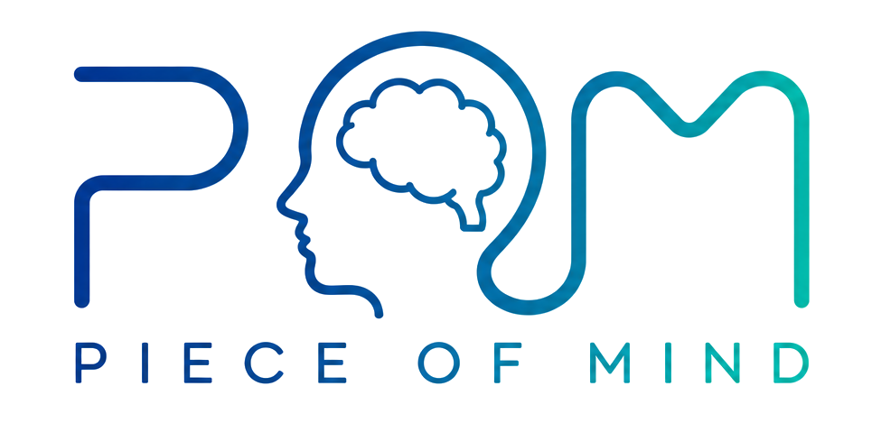

<p align="center">
  <picture>
    <source media="(prefers-color-scheme: dark)" srcset="assets/brand/pom-logo-dark.png">
    
  </picture>
</p>

# POM - Piece of Mind

**AI on your own computers, for free. Every machine holds a piece of the mind.**

POM pools the computers you already own to run AI models too big for any one of
them. Each computer holds one piece of the model, and they all work together to
answer: the question passes from one machine to the next and the answer comes
back to you, with no server in the middle and no expert needed. The answers can
come from your own machines, or from a network of computers you trust.

Good AI does not have to live in the cloud. Or you can be your own cloud.

- Website: <https://pieceofmind.cloud>
- Community: <https://discord.gg/d6Yjkk8ej>
- Windows, macOS and Linux - open source (AGPL-3.0, see `LICENSE`)

> POM is in pre-launch: the packaged downloads on the website are open to invited
> people only. Building from source (below) is open to everyone.

---

## Why POM

Cloud AI is rented: you pay every month, you depend on the rules of whoever owns
it, and your questions, documents and customers' data leave your hands. Running
it at home hits a wall instead: when a model does not fit on one graphics card,
the rest spills into ordinary memory, which is far slower, while the other
computers in the house sit idle.

POM splits the model into slices sized to each machine's memory and each computer
holds its own slice. In a test run from 1 to 6 October 2026 with two home
computers linked over the internet (about 6 ms apart), the same short answer with
the same 24.6 GB model took:

| Setup | Time |
|---|---|
| 3 cards in 2 homes, split by POM | 3.1 s |
| 2 cards in one machine | 3.7 s |
| 1 card of 16 GB (the model does not fit) | ~80 s |

In the same run, DeepSeek V4 Flash, which does not load on either machine alone,
answered without an error once POM pooled the two.

**Closer is better.** The question passes through one machine at a time, so the
distance between machines matters: prefer computers in the same house or the same
city.

## What you get

- **Models bigger than any one machine** - add up the memory of several ordinary
  computers.
- **The model never leaves home** - each computer uses its own copy of the model
  and loads only its piece; only the progress of the answer travels between
  machines, never the weights.
- **No server, no sign-up** - there is no central server to maintain and no
  account to create. Install it, start it, and the computers find each other.
- **Not all in one room** - POM links computers in different homes over the
  internet (relays and NAT hole punching included), and works best within the
  same city or region.
- **A simple dashboard on every machine** - see who is connected, deploy models
  and follow everything from the browser. Any machine works as the front door.
- **Works with the apps you already use** - POM speaks the OpenAI
  (`/v1/chat/completions`, `/v1/completions`) and Anthropic (`/v1/messages`)
  APIs. In most apps, switching over means changing one address. Coding agents
  such as OpenCode, Claude Code and Pi can use it as their model.

## Networks

- **Local or private network** - the machines in your home or company. Only
  people with your network's key can join, and questions and answers stay
  between your computers. Best for sensitive data and for companies.
- **Public network** - from the dashboard, look up a public network, see where it
  is and join with one click. Your computer works for the network and, together
  with the other members, you run models nobody could run alone. Best if you have
  little hardware; keep sensitive data on a private network.

## Plugins and POM Enterprise

The free POM is complete. It grows with plugins, some free and some paid, which
you install from the POM dashboard and which run isolated in their own process.
The store lives at <https://pieceofmind.cloud/plugins/>; paid plugins are
optional monthly or yearly subscriptions (for example *POM Logs / Statistics*
and *RAG Vector Database (Qdrant)*), see <https://pieceofmind.cloud/precos/>.

**POM Enterprise** is the edition for companies that want AI fully under control:
private network only, logs and auditing (who asked, when and on which machine),
usage statistics per machine and model, and connection to the team's coding
agents.

To build a plugin, start from `.claude/skills/creating-pom-plugins/`; the
contract is in `docs/subsystems/enterprise-licensing.md` and
`docs/subsystems/plugins-ui.md`.

---

## Building from source

```bash
# Rust toolchain
curl --proto '=https' --tlsv1.2 -sSf https://sh.rustup.rs | sh

git clone https://github.com/pieceofmindcloud/pom
cd pom
cargo build --release                       # CPU -> ./target/release/pom
cargo build --release --features metal      # Apple Silicon
cargo build --release --features cuda       # NVIDIA (pin CUDAARCHS, see below)

cd apps/frontend && npm install && npm run build   # the web interface
```

The build needs the `llama.cpp` fork checked out (or symlinked) at `./llama.cpp`
on the `pom-tensor-parallel` branch, and the inference engine is fetched from a
pinned git dependency. With `--features cuda`, set `CUDAARCHS` to your GPU's
architecture (for example `CUDAARCHS=120`) or llama.cpp compiles every CUDA
object for ten architectures. Details: `docs/subsystems/build-and-run.md`.

The web interface is read from disk at `apps/frontend/dist` at runtime
(`POM_UI_DIST` overrides it), so `cargo build` needs no Node.

## Running

```bash
./target/release/pom
```

With no `pom.json`, the node creates a local network of its own and opens the
interface at `http://localhost:8080/`, where a first-run wizard asks one name for
the machine and its network. Start POM on the other computers: on the same LAN
they find each other on their own. Deploying a model, joining other networks and
admitting machines all happen in the interface; the model never comes from the
command line.

Useful flags:

```bash
./pom --bootstrap 192.168.1.10:42777          # join through a known node
./pom --port 42778 --gateway-port 8091        # a second node on the same machine
                                              # (needs its own POM_HOME)
```

Every node serves the interface and the API on its gateway port (8080). See
`docs/subsystems/operations.md` for bringing up a cluster and the field gotchas.

## Docker

```bash
./scripts/build-docker.sh

docker run --rm \
    -p 8080:8080 -p 42777:42777/udp -p 8181:8181 \
    -v ./data:/data -e POM_HOME=/data -e POM_UI_DIST=/app/apps/frontend/dist \
    pom
```

Add `--bootstrap <host>:42777` after `pom` to join an existing node. The image
carries CPU, CUDA and Vulkan backends plus `pom-plugin-host`; the GGML modules
pick whichever backend is available at runtime. Build modes and variables are in
`docs/subsystems/build-and-run.md`.

---

## How it works

1. **Discovery** - each node announces itself over UDP on the LAN and through an
   iroh endpoint (QUIC, relays, hole punching) beyond it. The node's identity is
   its key, never its IP. → `docs/subsystems/p2p-network.md`
2. **Deployment** - the interface measures each node's memory and GPUs, plans
   which layers each one serves, and every peer extracts its own range from its
   own copy of the GGUF. No weight travels the network because of slicing.
   → `docs/subsystems/deployment.md`, `docs/subsystems/slicing.md`
3. **Inference** - whoever holds layer 0 processes the prompt; the hidden state
   crosses the pipeline in f16 by default, hop by hop, and the answer streams back
   to the gateway. Tensor parallelism is chosen when the topology favours it.
   → `docs/subsystems/inference.md`, `docs/subsystems/parallelism.md`
4. **Security** - between nodes it is always mutual TLS with certificates derived
   from each node's key; the network key alone opens nothing, admins are named by
   a signed trust chain and other members carry short-lived membership tokens.
   → `docs/subsystems/security-model.md`

## Repository map

```
crates/node/              the pom binary (network, gateway, inference, UI server)
crates/routing-contract/  serializable, versioned routing contract
crates/routing-base/      open, infrastructure-independent planner
crates/types/             extraction point for public domain types
crates/brand/             product identity, from brand.json
crates/enterprise-protocol/, crates/plugin-host/   plugin C ABI, IPC and host
apps/frontend/            React/Vite interface
docs/subsystems/          how each subsystem works and why
```

`AGENTS.md` at the root is the map for contributors (and agents); each folder
has its own `AGENTS.md`. This README is a presentation, not the architecture
reference.
