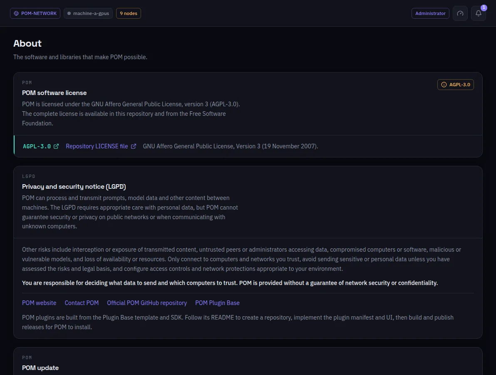

:::lead
About says what POM is made of and under which terms: its license, the privacy and security notice, the libraries it depends on, and the check for a newer POM.
:::

:::cards
### License
POM is licensed under the MIT License.
### Privacy and security (LGPD)
POM moves prompts and model data between machines and cannot guarantee privacy on public networks or with unknown computers. You decide what data to send and which computers to trust.
### Libraries
Everything a POM build ships - the interface packages, the Rust crates (transitive ones included) and the native libraries compiled in - grouped by license.
### POM update
Checks the POM releases on GitHub (the website as fallback) and applies one only after you authorize it; the node restarts on the new version. It needs no license.
:::

:::deep docs/subsystems/enterprise-licensing.md
How POM updates itself
:::
