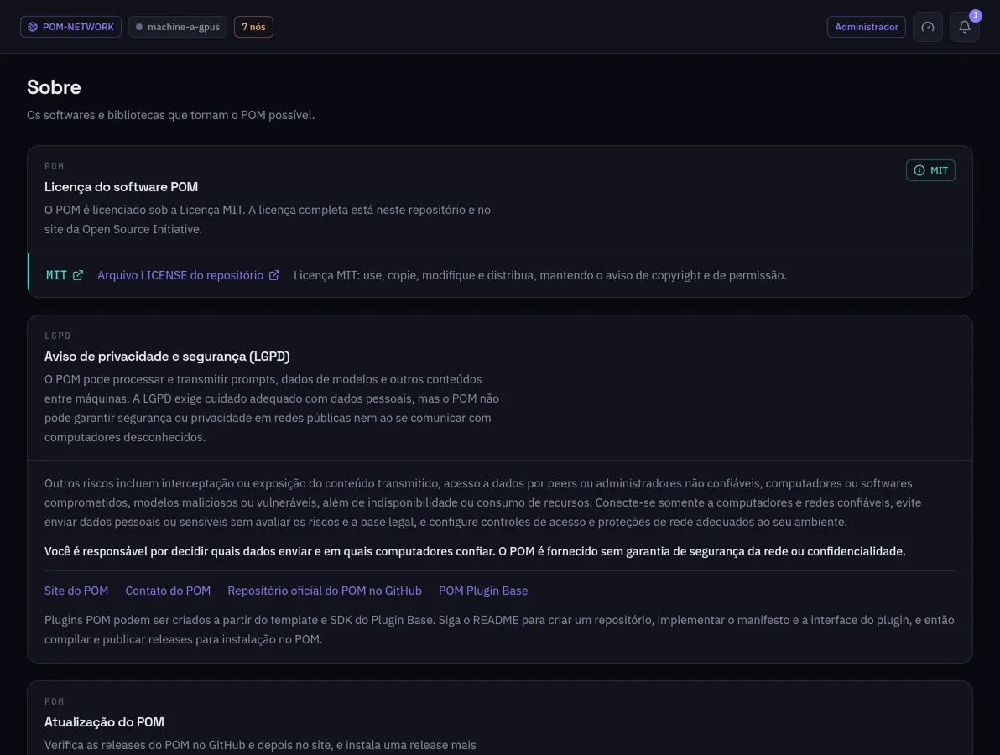

:::lead
Sobre diz do que o PoM é feito e em que termos: a licença, o aviso de privacidade e segurança, as bibliotecas de que depende e a verificação de um PoM mais novo.
:::

:::cards
### Licença
O PoM é licenciado sob a Licença MIT.
### Privacidade e segurança (LGPD)
O PoM move prompts e dados de modelos entre máquinas e não garante privacidade em redes públicas ou com computadores desconhecidos. Você decide que dados enviar e em quais computadores confiar.
### Bibliotecas
Tudo o que um build do PoM distribui - os pacotes da interface, os crates Rust (inclusive os transitivos) e as bibliotecas nativas compiladas junto - agrupado por licença.
### Atualização do PoM
Consulta as versões do PoM no GitHub (o site como alternativa) e aplica uma só depois que você autoriza; o nó reinicia na versão nova. Não precisa de licença.
:::

:::deep docs/subsystems/enterprise-licensing.md
Como o PoM se atualiza
:::
