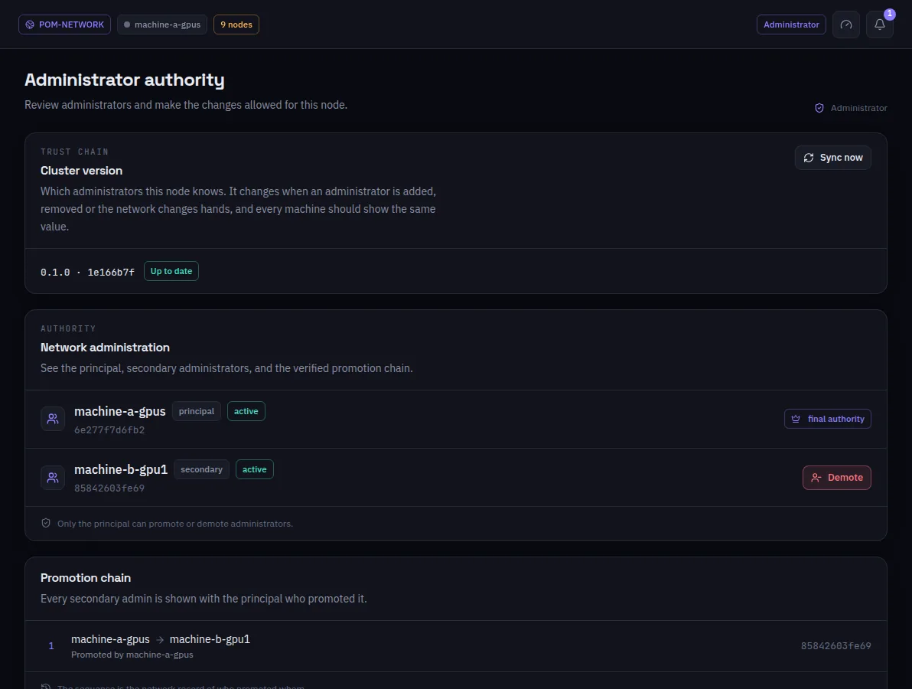

:::lead
Administrators shows who governs the network: the principal administrator, the secondary ones, and the signed chain that says who promoted whom. It also tells whether this machine has the same version of that chain as the rest of the network.
:::

:::cards
### Cluster version
The version of the trust chain this node knows. It changes when an administrator is added or removed or the network changes hands, and every machine should show the same value. **Sync now** fetches it again.
### Principal
The final authority: settings, keys, admins and every change to the trust chain come from it.
### Secondary administrators
They deploy models, decide admissions and remove workers and visitors - and nothing else. Only the principal promotes or demotes them.
### Promotion chain
Every secondary admin with the principal that promoted it: the network's record, signed, of who promoted whom.
:::

:::diagram profiles
The principal admin governs the network; the secondary admin deploys and admits; the worker serves layers; the visitor talks to the models.
:::

:::deep docs/subsystems/security-model.md
Roles, the trust chain and what each one may do
:::
