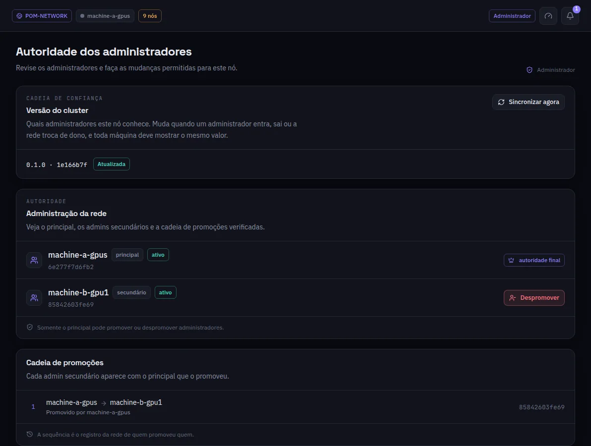

:::lead
Administradores mostra quem governa a rede: o administrador principal, os secundários e a cadeia assinada que diz quem promoveu quem. Também diz se esta máquina tem a mesma versão dessa cadeia que o resto da rede.
:::

:::cards
### Versão do cluster
A versão da cadeia de confiança que este nó conhece. Muda quando um administrador entra ou sai ou a rede troca de dono, e toda máquina deveria mostrar o mesmo valor. **Sincronizar agora** busca de novo.
### Principal
A autoridade final: configurações, chaves, admins e cada mudança na cadeia de confiança vêm dele.
### Administradores secundários
Implantam modelos, decidem admissões e removem workers e visitantes - e nada mais. Só o principal os promove ou rebaixa.
### Cadeia de promoções
Cada admin secundário com o principal que o promoveu: o registro da rede, assinado, de quem promoveu quem.
:::

:::diagram profiles
O admin principal governa a rede; o admin secundário implanta e admite; o worker serve camadas; o visitante conversa com os modelos.
:::

:::deep docs/subsystems/security-model.md
Papéis, a cadeia de confiança e o que cada um pode fazer
:::
