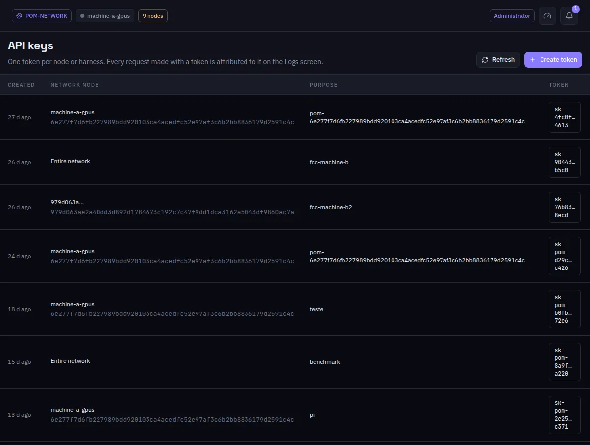

:::lead
API keys are the tokens an app, a harness or a coding agent uses to call this node's OpenAI- and Anthropic-compatible routes. One token per tool or person makes every request show up attributed to it in the Logs.
:::

:::steps
### Create a token
**Create token**, with a purpose that tells you later what it is for.
### Copy it once
The secret appears only once, in the window right after creation. The list keeps only a hint of it.
### Use it
Point the app at `http://<node>:8080/v1` and give it the token, as Bearer or as `x-api-key`.
:::

:::note A key never leaves its node
A token is valid only on the node that minted it, and it survives a change of network. The other machines accept the work because the gateway is a member, not because of the client's key.
:::

:::diagram api
The client calls any gateway with an API key; the answer comes back with x_pom.source telling which machines worked.
:::

:::deep docs/subsystems/http-api.md
Every route and how it authenticates
:::
