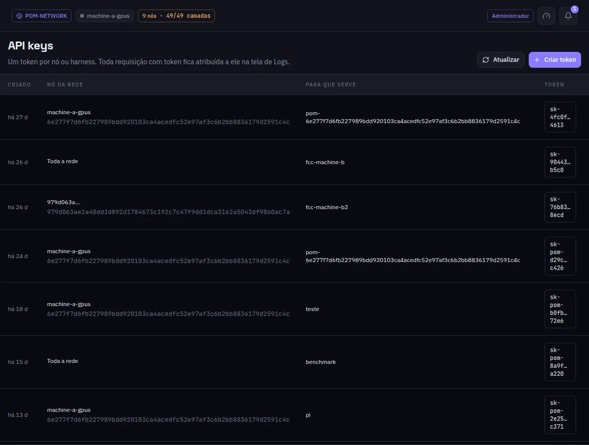

:::lead
API keys são os tokens que um app, um harness ou um agente de código usa para chamar as rotas compatíveis com OpenAI e Anthropic deste nó. Um token por ferramenta ou pessoa faz cada requisição aparecer atribuída a ele nos Logs.
:::

:::steps
### Criar um token
**Criar token**, com um propósito que diga depois para que ele serve.
### Copiar uma vez
O segredo aparece uma única vez, na janela logo depois de criar. A lista guarda só uma dica dele.
### Usar
Aponte o app para `http://<nó>:8080/v1` e dê o token, como Bearer ou como `x-api-key`.
:::

:::note Uma chave nunca sai do nó dela
Um token só vale no nó que o criou, e sobrevive a uma troca de rede. As outras máquinas aceitam o trabalho porque o gateway é membro, não por causa da chave do cliente.
:::

:::diagram api
O cliente chama qualquer gateway com uma chave de API; a resposta volta com x_pom.source contando quais máquinas trabalharam.
:::

:::deep docs/subsystems/http-api.md
Cada rota e como ela autentica
:::
