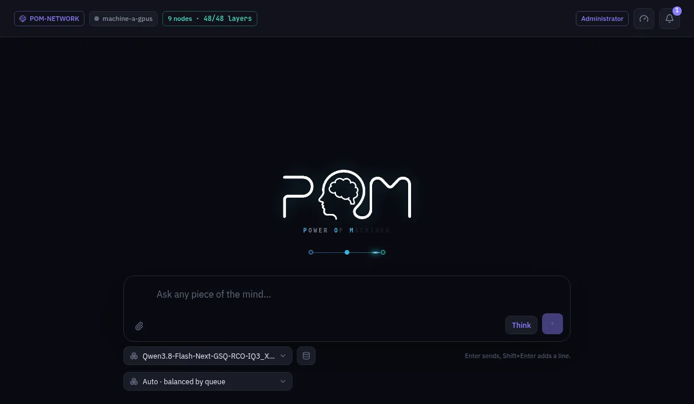

:::lead
The Chat talks to the model your network serves, through the same OpenAI-compatible route any other app would use. Every answer can show which machines worked on it and how long each step took.
:::

## Below the box

:::cards
### Model
Which model answers. Only models some machine of the network is serving show up here.
### Inference head
When more than one machine holds the first layer, this picker chooses through which one the question enters. **Auto** balances by the queue of each one.
### Think
Shows up only for a model that can think before answering. The choice stays with the conversation until you change it.
### Attachments
The clip adds one or more files to the message; images go to models that have vision. A PDF is turned into text before it is sent, and scanned pages are read by OCR, which takes a few seconds per page and can misread a word, so that attachment shows an OCR mark. A PDF can have up to 100 MB, 1000 pages and 100 scanned pages.
:::

## Generating images

When the network serves an image model, a **Generate image** menu appears below the box. In **Automatic** (the default) just ask for a picture: the model writes a detailed prompt from the conversation and makes the image, and **Prompt** under the images shows what it wrote. **Always image** sends every message straight to the workflow, and **Text only** never makes images. The same menu picks the workflow - each image model offers a ready text-to-image one, and an administrator can publish any ComfyUI workflow with **POM > Publish to Chat**. While it works the answer shows the pieces coming together with the step, then the images as thumbnails. A click opens one full size with **Download**. The same menu picks the image size. Attach an image to the message to use it as the base: the new image starts from it (with the ready workflow, or a published one that takes an image). The images are copied to this node and kept in `.comfyui/images` inside the workspace, named by their content, so they stay when the machine that made them goes away; the conversation keeps only that name. **Text answer** goes back to the language model.

## After an answer

Each answer carries a short line with the time to the first token and the speed of the generation. Opening it shows the full telemetry: the machines of the path, the network time between them, how long each hop took and the format of the hidden state that crossed the network. A thought, when the model thinks, stays closed above the answer and opens on a click.

:::note When the Chat shows a missing piece
No machine of the network is serving a model yet. An administrator sees the three steps that are missing - download a model, deploy it, talk - and where each one is done. A machine that has just joined a network sees "Connecting" until the network lets it in.
:::

:::note Enter sends
Enter sends the message, Shift+Enter starts a new line. Conversations stay on the left, in this browser.
:::

:::deep docs/subsystems/inference.md
What happens to a question between the gateway and the last machine
:::
