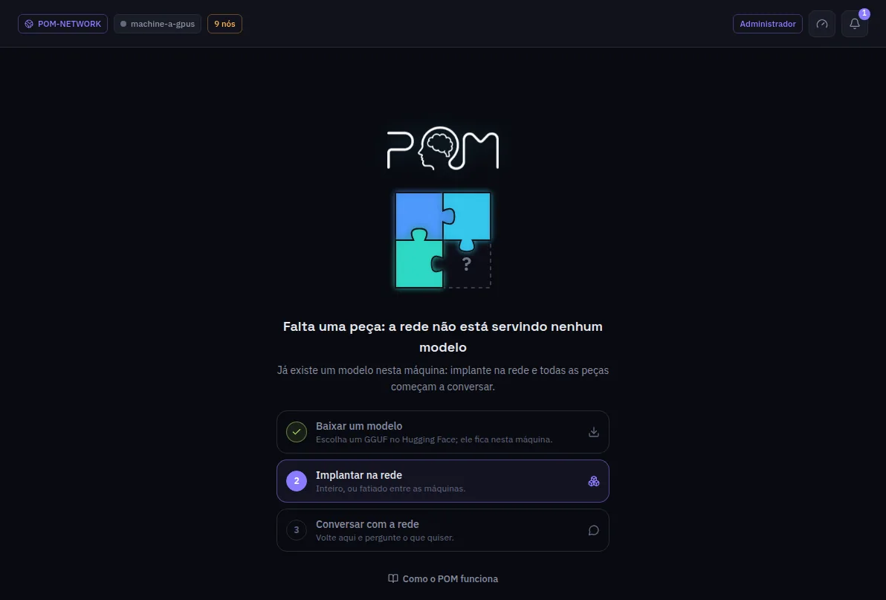

:::lead
O Chat conversa com o modelo que a sua rede serve, pela mesma rota compatível com a OpenAI que qualquer outro aplicativo usaria. Cada resposta pode mostrar quais máquinas trabalharam nela e quanto durou cada etapa.
:::

## Embaixo da caixa

:::cards
### Modelo
Qual modelo responde. Só aparecem aqui os modelos que alguma máquina da rede está servindo.
### Cabeça de inferência
Quando mais de uma máquina tem a primeira camada, este seletor escolhe por qual delas a pergunta entra. **Auto** balanceia pela fila de cada uma.
### Think
Aparece só para um modelo que sabe pensar antes de responder. A escolha fica com a conversa até você mudar.
### Anexos
O clipe adiciona um ou mais arquivos à mensagem; imagens vão para modelos que têm visão. Um PDF vira texto antes do envio, e páginas escaneadas são lidas por OCR, que leva alguns segundos por página e pode trocar uma palavra, por isso esse anexo mostra uma marca OCR. Um PDF pode ter até 100 MB, 1000 páginas e 100 páginas escaneadas.
:::

## Depois de uma resposta

Cada resposta traz uma linha curta com o tempo até o primeiro token e a velocidade da geração. Abrindo, aparece a telemetria completa: as máquinas do caminho, o tempo de rede entre elas, quanto durou cada salto e o formato do estado oculto que atravessou a rede. O pensamento, quando o modelo pensa, fica fechado acima da resposta e abre com um clique.

:::note Quando o Chat mostra uma peça faltando
Nenhuma máquina da rede está servindo um modelo ainda. O administrador vê os três passos que faltam - baixar um modelo, implantar, conversar - e onde cada um é feito. Uma máquina que acabou de entrar numa rede vê "Conectando" até a rede deixá-la entrar.
:::

:::note Enter envia
Enter envia a mensagem, Shift+Enter quebra a linha. As conversas ficam à esquerda, neste navegador.
:::

:::deep docs/subsystems/inference.md
O que acontece com uma pergunta entre o gateway e a última máquina
:::
