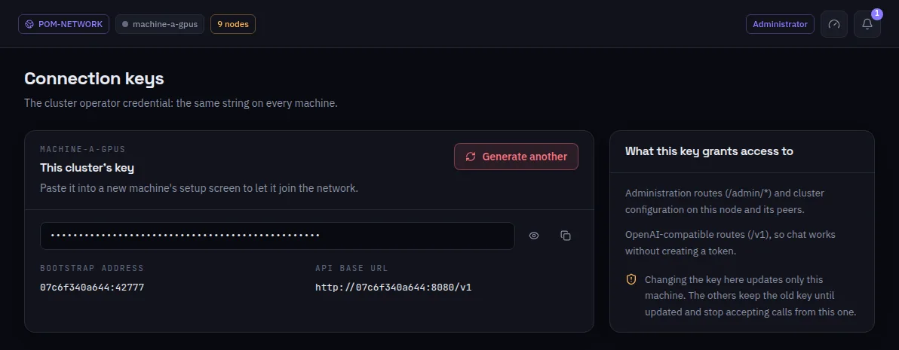

:::lead
The connection key is the network's operator credential: the same string on every machine of the network. It authenticates the administration routes and the synchronization between nodes.
:::

:::cards
### What it grants
The administration routes (`/admin/*`) and the cluster configuration on this node and its peers.
### Bootstrap address and API base URL
The address a new machine uses to reach this one, and the base of the compatible API.
### Generate another
Rotates the key on this machine only. The others keep the old one until updated and stop accepting calls from this one in the meantime.
:::

:::warn The key alone opens nothing
Every member holds this key, so it is not what decides who may do what: between machines it is always mutual TLS, and each call also needs the caller to be an admin of the chain or a member with a valid token. Only the administrator sees this screen.
:::

:::deep docs/subsystems/security-model.md
Mutual TLS, membership and the connection key
:::
