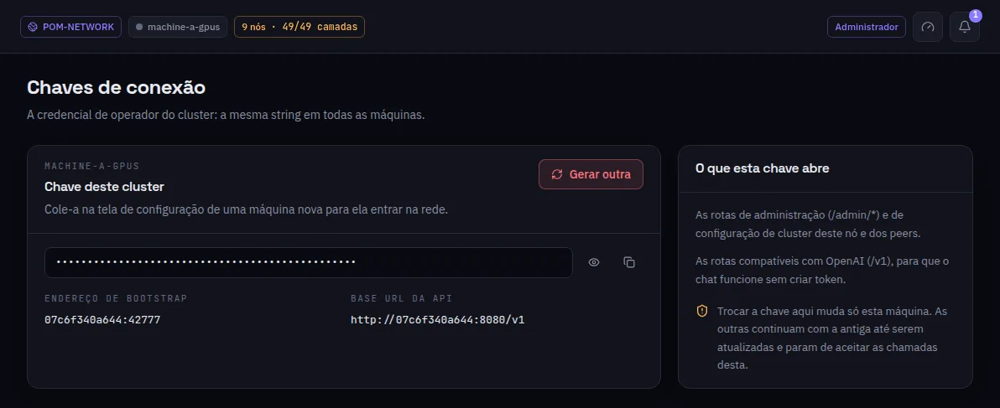

:::lead
A chave de conexão é a credencial de operador da rede: a mesma string em todas as máquinas da rede. Ela autentica as rotas de administração e a sincronização entre os nós.
:::

:::cards
### O que ela abre
As rotas de administração (`/admin/*`) e a configuração do cluster neste nó e nos peers.
### Endereço de bootstrap e URL base da API
O endereço que uma máquina nova usa para chegar a esta, e a base da API compatível.
### Gerar outra
Troca a chave só nesta máquina. As outras ficam com a antiga até serem atualizadas e, enquanto isso, deixam de aceitar chamadas desta.
:::

:::warn A chave sozinha não abre nada
Todo membro tem esta chave, então não é ela que decide quem pode o quê: entre máquinas é sempre TLS mútuo, e cada chamada também exige que quem chama seja admin da cadeia ou membro com token válido. Só o administrador vê esta tela.
:::

:::deep docs/subsystems/security-model.md
TLS mútuo, associação e a chave de conexão
:::
