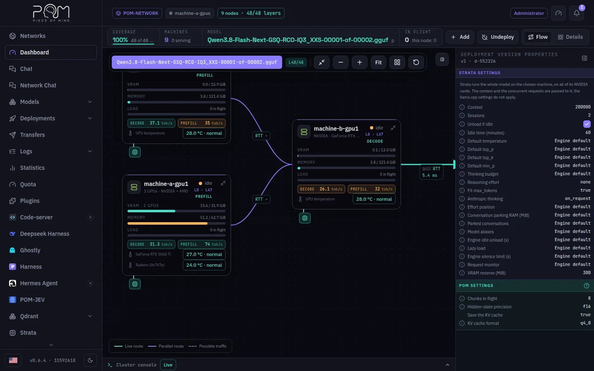

:::lead
The Dashboard is the first screen of an administrator: it shows whether the model in service is complete, which machines carry it, how fast each one answers and how a question travels from the gateway through the machines and back.
:::

## The bar at the top

:::cards
### Coverage
How many of the model's layers are served right now. Below 100% there is no answer: the request fails with the reason instead of answering worse.
### Machines
How many machines the network knows and how many of them are serving.
### Model
The model in service and whether its pipeline is complete.
### In flight
Requests being generated now, in the whole network and on this node.
:::

## Flow and Details

The **Flow** view draws the path of a question: each machine is a card with its VRAM, memory, load, its decode and prefill speeds and the GPU temperature, and the lines between them carry the measured round trip (RTT). The **Gateway** card closes the cycle with the cost of one token through the whole chain. The legend at the bottom tells the live route from a parallel route and from possible traffic.

The **Details** view lists the whole network, not only the pipeline: the machines of the deployment first, in layer order, and then the machines connected without a slice, which are exactly the ones that disappear when only the pipeline is looked at. With no model in service, Details is where the screen opens.

For privacy, another machine shares only a summary of itself: its disks come as one **Model storage** gauge, the free space of the volumes that can receive model slices, and its GPU processes list only POM's, with everything else added up as **Other processes**. Your own machine's card shows you everything, with a note under the disks and in the GPU processes saying that the other machines see only that summary.

:::note The panel on the right
It is the read-only view of the deployment's active version: the same inspector the Deploy screen edits, with the context, sessions, sampling and the POM settings it came up with.
:::

## What an administrator can do here

:::steps
### Pick the model on screen
The model chip at the top of the map chooses which deployment is drawn. Add, Undeploy and the properties panel follow that model.
### Add a machine
**Add** puts one more machine into the deployment; the dialog lists what the chosen machine already has on disk. When the machine has a vision projector for the model, a switch lets it read images; it starts on when the deployment already does.
### Undeploy
**Undeploy** takes the model out of service on every machine of the list it shows first.
### Follow the console
The **Cluster console** at the bottom opens upwards with the process logs of the machines, live.
:::

:::warn Other profiles see less
A worker or a visitor sees only the Flow, with this machine's own model, slice and requests. The Details view, Add and Undeploy belong to the administrator, and the node refuses those actions to anyone else whatever the screen shows.
:::

:::deep docs/subsystems/web-ui.md
Every panel of the interface
:::

:::deep apps/frontend/src/routes/AGENTS.md
How the Dashboard reads the cluster
:::
