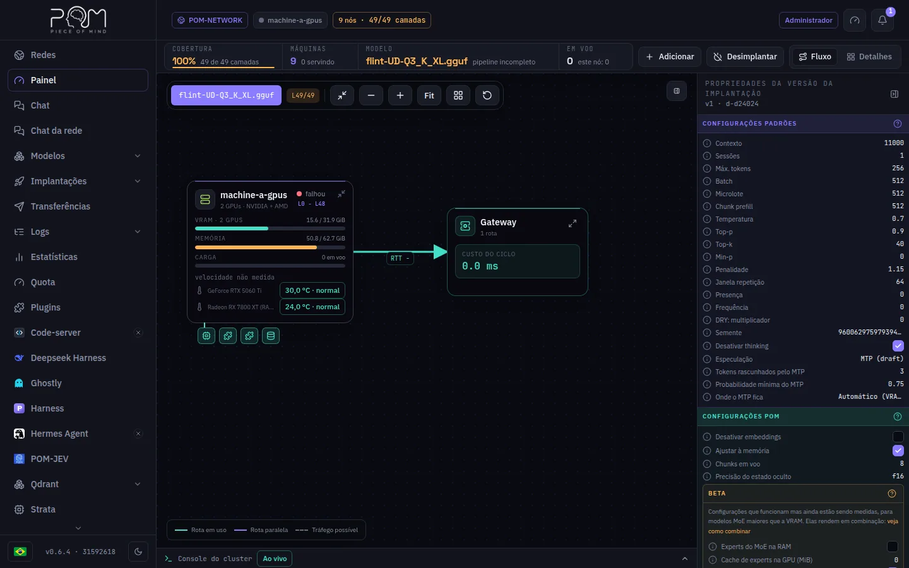

:::lead
O Painel é a primeira tela do administrador: mostra se o modelo em serviço está completo, quais máquinas o carregam, quão rápido cada uma responde e como uma pergunta vai do gateway pelas máquinas e volta.
:::

## A barra do topo

:::cards
### Cobertura
Quantas camadas do modelo estão servidas agora. Abaixo de 100% não há resposta: a requisição falha com o motivo em vez de responder pior.
### Máquinas
Quantas máquinas a rede conhece e quantas delas estão servindo.
### Modelo
O modelo em serviço e se o pipeline dele está completo.
### Em voo
Requisições sendo geradas agora, na rede toda e neste nó.
:::

## Fluxo e Detalhes

A visão **Fluxo** desenha o caminho de uma pergunta: cada máquina é um cartão com VRAM, memória, carga, velocidades de decode e prefill e a temperatura da GPU, e as linhas entre elas trazem o tempo de ida e volta medido (RTT). O cartão **Gateway** fecha o ciclo com o custo de um token pela cadeia inteira. A legenda embaixo separa a rota em uso de uma rota paralela e do tráfego possível.

A visão **Detalhes** lista a rede inteira, não só o pipeline: primeiro as máquinas da implantação, na ordem das camadas, e depois as máquinas conectadas sem fatia, que são justamente as que somem quando se olha só o pipeline. Sem modelo em serviço, a tela abre em Detalhes.

Uma máquina com GPU cujas camadas não couberam todas na VRAM mostra um aviso âmbar ao lado da sua faixa de camadas: o llama.cpp rodou o resto na CPU, o que deixa essa máquina bem mais lenta. O aviso diz quantas camadas sobraram e o que fazer (liberar VRAM, reduzir o contexto ou as sessões, ou dar menos camadas a essa máquina). Macs, com memória unificada, e máquinas sem GPU nunca o mostram.

Por privacidade, outra máquina compartilha só um resumo de si: seus discos aparecem como um único medidor de **Armazenamento de modelos**, o espaço livre dos volumes que podem receber fatias de modelo, e seus processos na GPU listam só os do POM, com o resto somado em **Outros processos**. O cartão da sua própria máquina mostra tudo, com um aviso embaixo dos discos e nos processos da GPU dizendo que as outras máquinas veem só esse resumo.

:::note O painel da direita
É a leitura da versão ativa da implantação: o mesmo inspetor que a tela Implantar edita, com o contexto, as sessões, a amostragem e as configurações do POM com que ela subiu.
:::

## Modelos de imagem

Um modelo de imagem escolhido no seletor de modelo (marcado com um ícone de imagem) aparece como a sua pipeline: o **text encoder**, o **modelo de difusão** e o **VAE**, na ordem em que a imagem é feita, cada estágio com as máquinas que o servem. Cada máquina mostra se está pronta, o tempo de ida e volta a partir deste nó e as chamadas que atende agora. O ComfyUI chama cada estágio da máquina onde roda, e cada chamada vai para a réplica pronta mais próxima. **Adicionar réplica** põe mais uma máquina num estágio, entre as que têm o arquivo; **Tirar do ar** libera o modelo em todas as máquinas da lista que mostra antes, a partir do nó de qualquer administrador.

## O que o administrador faz aqui

:::steps
### Escolher o modelo na tela
O chip do modelo no topo do mapa escolhe qual implantação é desenhada. Adicionar, Desimplantar e o painel de propriedades seguem esse modelo.
### Adicionar uma máquina
**Adicionar** coloca mais uma máquina na implantação; o diálogo lista o que a máquina escolhida já tem no disco. Quando a máquina tem um projetor de visão para o modelo, uma chave permite que ela leia imagens; ela já vem ligada quando a implantação já lê.
### Desimplantar
**Desimplantar** tira o modelo de serviço em todas as máquinas da lista que ele mostra antes.
### Acompanhar o console
O **Console do cluster**, embaixo, abre para cima com os logs de processo das máquinas, ao vivo.
:::

:::warn Os outros perfis veem menos
Um worker ou um visitante vê só o Fluxo, com o modelo, a fatia e as requisições desta máquina. A visão Detalhes, Adicionar e Desimplantar são do administrador, e o nó recusa essas ações a qualquer outro, mostre a tela o que mostrar.
:::

:::deep docs/subsystems/web-ui.md
Cada painel da interface
:::

:::deep apps/frontend/src/routes/AGENTS.md
Como o Painel lê o cluster
:::
