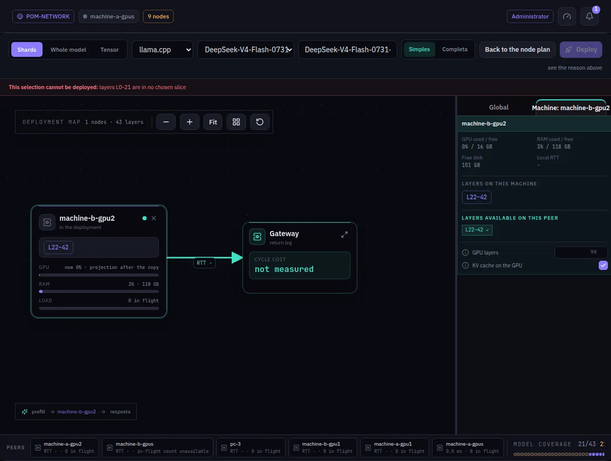

:::lead
Deploy to network is the studio where a model goes into service: you choose what to deploy, place the machines on the map, read the planner's verdict and adjust the settings before pressing Deploy.
:::

## The three parts of the screen

:::cards
### The top bar
What to deploy: **Shards** (a set of slices, one range per machine) or **Whole model** (the whole file on a machine). Beside it, the engine (llama.cpp, or an inference service a plugin publishes), the model and the deployment's name.
### The map
The machines in the deployment, each with the layer range it will serve, the memory it has and the projection after loading. The **Gateway** closes the cycle with the cost of one token once it can be measured.
### The inspector
**Global** holds the settings of the whole deployment (context, sessions, sampling, the POM settings); the machine tab holds what is per machine: GPU layers and whether the KV cache goes on the GPU.
:::

## From choice to service

:::steps
### Choose the model
For Shards, the model list shows the slice sets some machine of the network already has. For Whole model, the whole GGUF files.
### Put the machines on the map
Drag machines from the strip at the bottom to the map. The planner places the ranges, and **Model coverage**, at the bottom right, counts the layers covered.
### Read the verdict
When the selection cannot be deployed, a red line at the top says why - for example, which layers are in no chosen slice. The Deploy button stays off until the plan closes.
### Deploy
Each machine extracts or loads its own range. A window follows the deploy step by step until it is ready or fails, with the reason; **Switch to dashboard** takes you to the Dashboard, and **Close** leaves the deploy running, its result staying in the bell. The deployment shows up in the Dashboard as soon as the machines confirm they are serving. A deployment is deployed once at a time: pressing Deploy again while it comes up only reopens that window.
:::

:::diagram lifecycle
The life of a slice: only the state the node itself confirmed lets it come back after a restart.
:::

:::warn Copies need your permission
If a machine does not have the file it needs, the deploy is refused unless you allow transfers - and the screen lists the copies before asking. Weights never move because of slicing alone.
:::

:::note Settings help
Each category of the inspector has a help button that opens its guide: Default settings and POM settings.
:::

## Image models

**Image model** in the mode bar turns the studio into an image pipeline. An image model (Z-Image, Qwen Image, Flux...) is served by stage, in the order the image is made: the **text encoder** reads the prompt, the **diffusion model** draws the image step by step, and the **VAE** turns the result into pixels. Each stage runs on machines that run ComfyUI and already hold that stage's file, so a small GPU can hold the diffusion model while the others live elsewhere.

:::steps
### Choose the files
Choose the diffusion model's file. The text encoder and the VAE are filled in when the same folder holds exactly one of each; change them if you want others.
### Drag machines onto the stages
Drag machines from the strip at the bottom onto each stage. More than one machine on a stage makes replicas: each call goes to the nearest one that answers, and the image keeps going when one of them stops. One machine can serve several stages; the small VAE usually rides along with another one. A machine that cannot take a stage says why on its card.
### Read the verdict and deploy
The red line at the top says what is still missing. Deploy follows the same progress window as a language model, and the deployment shows on the Dashboard and in Deployments.
:::

ComfyUI on any machine of the network lists the stages as `POM ▸ <name> ▸ <file>` in its ordinary loaders, and the Chat can generate images with it. Nothing is copied: a machine without the file is not offered.

:::deep docs/subsystems/deployment.md
The plan, the merge, the order and the slice lifecycle
:::

:::deep docs/subsystems/parallelism.md
Pipeline or tensor parallelism
:::
