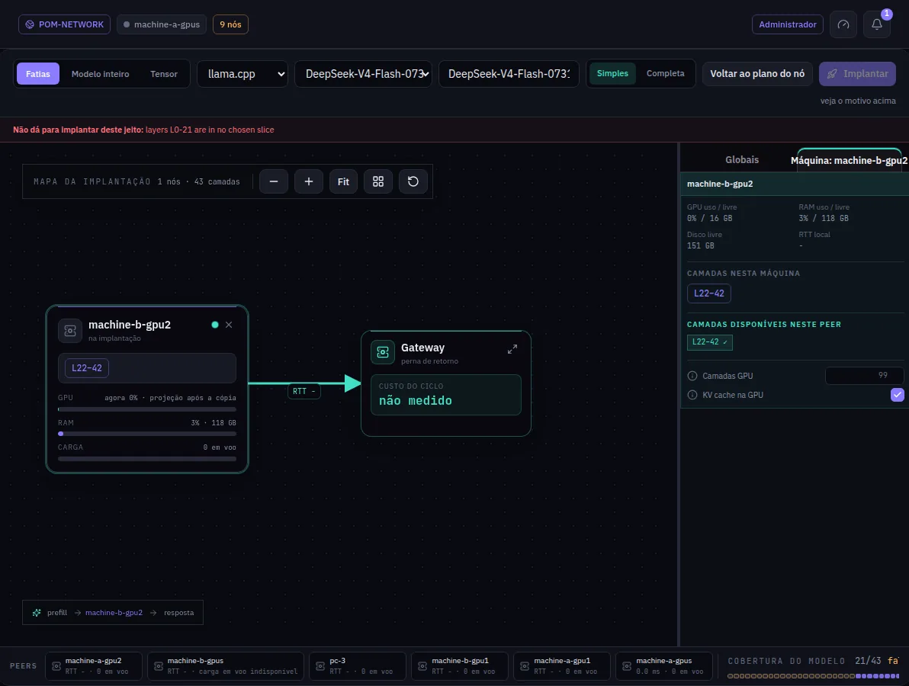

:::lead
Implantar na rede é o estúdio onde um modelo entra em serviço: você escolhe o modelo, põe as máquinas no mapa, dá a cada máquina as camadas que ela serve e aperta Implantar, que verifica o mapa e diz por que ele não pode rodar, se não puder.
:::

## As três partes da tela

:::cards
### A barra do topo
O que implantar: **Pipeline** (um modelo de linguagem, a partir do GGUF inteiro) ou **Modelo de imagem**. Ao lado, o motor (llama.cpp, ou um serviço de inferência que um plugin publica), o modelo, o nome da implantação e o botão Implantar.
### O mapa
As máquinas da implantação, cada uma com as faixas de camadas que vai servir e a GPU, a RAM e a carga ao vivo. Uma máquina segue a ordem do pipeline assim que tem uma faixa; **Organizar** devolve ao lugar os cartões que você arrastou. Arraste o fundo pontilhado para andar pelo mapa; a roda do mouse ou a pinça do trackpad dá zoom. O **Gateway** fecha o ciclo.
### O inspetor
**Globais** guarda as configurações da implantação inteira (contexto, sessões, amostragem, as configurações do POM). **Máquinas** lista todas as máquinas do mapa, na ordem do pipeline, só com o que você edita por máquina: as faixas de camadas, as camadas na GPU e se o cache KV vai para a GPU.
:::

## Da escolha ao serviço

:::steps
### Escolher o modelo
Os arquivos GGUF inteiros que alguma máquina conhece.
### Pôr as máquinas no mapa
O mapa abre na última implantação do modelo, ou então nas máquinas que o têm, com as camadas divididas entre elas. Arraste mais máquinas da faixa de baixo; elas entram sem faixa, e você dá camadas a elas na aba Máquinas. Uma máquina que serve a camada 0 é uma **Cabeça**: ela recebe os prompts. As arestas entre os estágios mostram o RTT medido entre as máquinas. Nada é verificado enquanto você edita, então o mapa nunca se redesenha sozinho: **Cobertura do modelo**, no canto de baixo, conta as camadas cobertas.

O cartão de uma máquina que não tem o modelo avisa. **Baixar aqui** faz ela baixar o mesmo repositório e arquivo do Hugging Face que outra máquina baixou, com todas as partes de um arquivo dividido; o cartão passa a mostrar o progresso. Para um arquivo copiado à mão, coloque-o numa das pastas de modelos dessa máquina e aperte **Varrer**. Um modelo que ninguém baixou pelo POM oferece só Varrer. O mesmo vale para um projetor de visão ou um rascunho MTP que a implantação precisa numa máquina que não o tem. Uma máquina sem o modelo nunca recebe uma cópia pela rede.
### Dar a cada máquina as suas camadas
Na aba **Máquinas**, cada máquina que tem o arquivo inteiro pode servi-lo inteiro (**Modelo inteiro**) ou uma faixa. A faixa tem um controle deslizante com duas alças que só param em cortes que o modelo permite; aperte em qualquer ponto da trilha e a alça mais próxima segue o mouse, então qualquer faixa escolhida pode ser servida: cada máquina lê as camadas da própria cópia do arquivo inteiro, nada é gravado nem copiado. **Dividir as camadas entre N máquinas** divide as camadas por igual, na ordem da lista, entre as máquinas com a caixa marcada (Shift+clique num cartão também marca ou desmarca). Uma máquina desmarcada mantém as faixas e as configurações: as marcadas dividem as camadas que ela não serve, ou o modelo inteiro quando as desmarcadas já servem tudo. O nome da implantação começa como o nome do modelo sem `.gguf` e sem o número da parte de um arquivo dividido. As setas de cada máquina a sobem ou descem na lista, que é a ordem do pipeline: as máquinas com faixa trocam as faixas entre si, então a primeira da lista serve a camada 0. Duas máquinas na mesma faixa são réplicas.
### Implantar
Apertar Implantar verifica o mapa uma vez contra a rede como ela está agora. Quando o mapa não pode rodar - camadas que nenhuma máquina serve, duas faixas que se sobrepõem, uma máquina sem o modelo - uma janela lista o porquê e nada é implantado. Um mapa que deixa camadas sem máquina pergunta antes de seguir; máquinas que já servem um modelo são nomeadas antes de serem tomadas. Depois cada máquina carrega a própria faixa. Uma janela acompanha a implantação passo a passo até ela ficar pronta ou falhar, com o motivo; **Ir para o painel** leva ao Painel, e **Fechar** deixa a implantação seguindo, com o resultado no sino. Uma implantação é feita uma vez por vez: apertar Implantar de novo enquanto ela sobe só reabre essa janela.
:::

:::diagram lifecycle
O ciclo de vida de uma fatia: só o estado que o próprio nó confirmou autoriza retomá-la depois de um reinício.
:::

:::note Ajuda das configurações
Cada categoria do inspetor tem um botão de ajuda que abre o guia dela: Configurações padrões e Configurações do POM.
:::

## Modelos de imagem

**Modelo de imagem** na barra de modos transforma o estúdio numa pipeline de imagem. Um modelo de imagem (Z-Image, Qwen Image, Flux...) é servido por estágio, na ordem em que a imagem é feita: o **text encoder** lê o prompt, o **modelo de difusão** desenha a imagem passo a passo e o **VAE** transforma o resultado em pixels. Cada estágio roda em máquinas que rodam o ComfyUI e já têm o arquivo daquele estágio, então uma GPU pequena guarda a difusão enquanto os outros ficam em outras máquinas.

:::steps
### Escolha os arquivos
Escolha o arquivo do modelo de difusão. O text encoder e o VAE são preenchidos quando a mesma pasta tem exatamente um de cada; troque se quiser outros.
### Arraste máquinas para os estágios
Arraste máquinas da barra de baixo para cada estágio. Mais de uma máquina num estágio são réplicas: cada chamada vai para a mais próxima que responder, e a imagem continua quando uma delas para. Uma máquina pode servir vários estágios; o VAE, pequeno, costuma ir junto com outro. Uma máquina que não pode receber um estágio diz o motivo no cartão.
### Leia o veredito e implante
A linha vermelha no topo diz o que ainda falta. Implantar segue a mesma janela de progresso de um modelo de linguagem, e a implantação aparece no Dashboard e em Implantações, que o botão Histórico à esquerda de Implantar abre.
:::

O ComfyUI de qualquer máquina da rede lista os estágios como `POM ▸ <nome> ▸ <arquivo>` nos loaders normais, e o Chat pode gerar imagens com ele. Nada é copiado: uma máquina sem o arquivo não é oferecida.

:::deep docs/subsystems/deployment.md
O plano, a fusão, a ordem e o ciclo de vida da fatia
:::

:::deep docs/subsystems/parallelism.md
Pipeline ou paralelismo de tensor
:::
