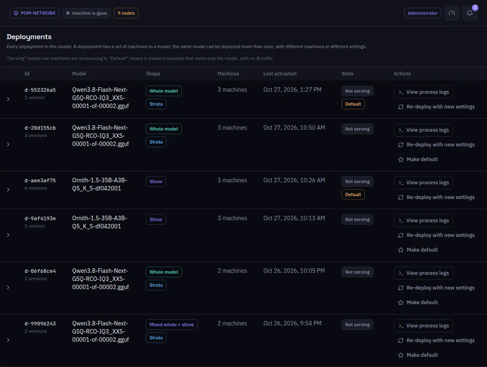

:::lead
Deployments is the history, opened from the History button beside Deploy on the Deploy screen: every deployment the network registered, newest activation first, with the machines it uses, whether it is serving and which one answers when a request names only the model.
:::

:::cards
### Serving and Default
**Serving** means live machines are announcing it. **Default** marks the deployment that answers a request naming only the model, with no `@` suffix. The same model can be deployed more than once, with other machines or other settings.
### Versions
A deployment keeps a version per change of settings or machines. Expanding the row lists them, newest first, with the active one marked and **Re-deploy this version** on each.
### Re-deploy with new settings
Opens the same inspector as the Deploy screen, seeded with the active version; **Reload with these settings** sends only what changed, on the same machines and the same layers.
### View process logs
Opens the Deployment logs filtered to this deployment.
:::

:::note The panel on the right
Clicking a version shows its settings read-only. The KV cache is not there on purpose: it belongs to the machine and to the moment, not to the version.
:::

## Image models

Image models are listed below the language models with an **Image model** badge: their stages and the machines of each one, whether every stage is served, and Undeploy. Opening a row shows its versions, newest first; adding or removing a replica on the Dashboard writes a new version, and **Redeploy this version** brings an older one back. Versions are kept by the node that deployed the model; any administrator's node lists it and can undeploy it.

:::deep docs/subsystems/deployment.md
Versions, the default deployment and redeploying
:::
