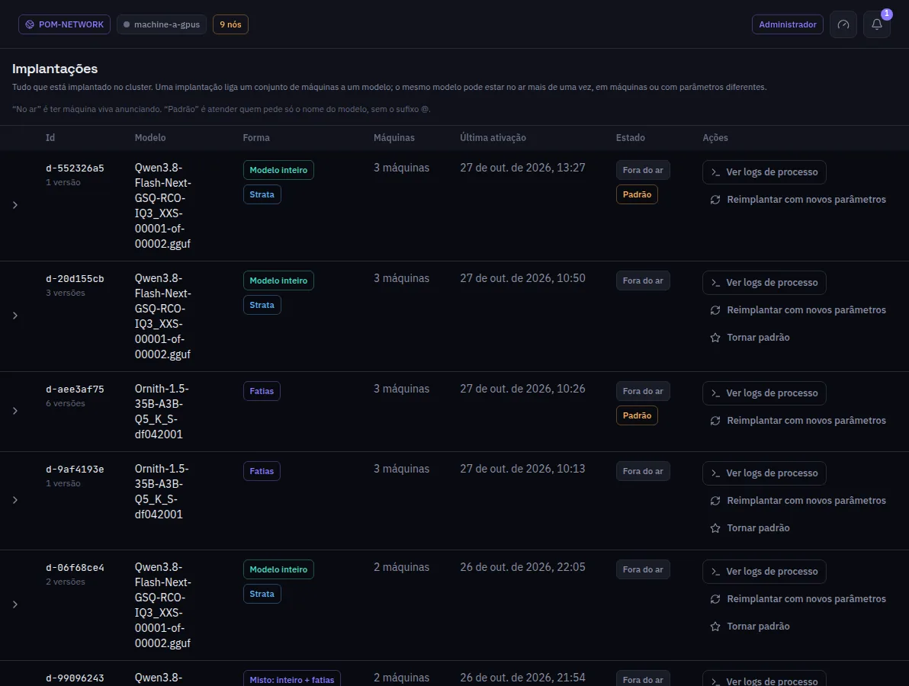

:::lead
Implantações é o histórico: cada implantação que a rede registrou, da ativação mais recente para a mais antiga, com as máquinas que ela usa, se está no ar e qual responde quando uma requisição dá só o nome do modelo.
:::

:::cards
### No ar e Padrão
**No ar** quer dizer que máquinas vivas estão anunciando a implantação. **Padrão** marca a que responde a uma requisição que dá só o nome do modelo, sem o sufixo `@`. O mesmo modelo pode ser implantado mais de uma vez, com outras máquinas ou outras configurações.
### Versões
Uma implantação guarda uma versão a cada mudança de configuração ou de máquinas. Expandir a linha lista as versões, da mais nova para a mais antiga, com a ativa marcada e **Reimplantar esta versão** em cada uma.
### Reimplantar com novos parâmetros
Abre o mesmo inspetor da tela Implantar, preenchido com a versão ativa; **Recarregar com estes valores** manda só o que mudou, nas mesmas máquinas e nas mesmas camadas.
### Ver logs de processo
Abre os Logs da implantação filtrados para esta implantação.
:::

:::note O painel da direita
Clicar numa versão mostra as configurações dela só para leitura. O cache KV não aparece de propósito: ele pertence à máquina e ao momento, não à versão.
:::

:::deep docs/subsystems/deployment.md
Versões, a implantação padrão e reimplantar
:::
