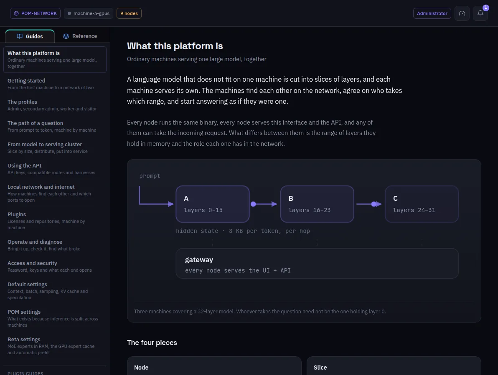

:::lead
Documentation has two halves. **Guides** are written for people: how POM works, one guide per screen, the deployment settings, and how each part of the code thinks. **Reference** is the living documentation of the repository, written for whoever changes the code.
:::

:::cards
### Search
The box at the top searches the tab that is open: in Guides, every title, summary and text; in Reference, every document.
### Guide groups
How it works, Screens, Deployment settings and Inside the code. A plugin can add guides of its own, listed after them.
### Go deeper
Each guide ends with links into the reference, for the full detail behind what it explains.
:::

:::note Where the text comes from
The guides are markdown files in the repository's `docs/guides/` and `docs/human/`, one per language; the reference is the `AGENTS.md` files and `docs/subsystems/`. Both travel inside the interface, so they work on any machine without the internet.
:::
