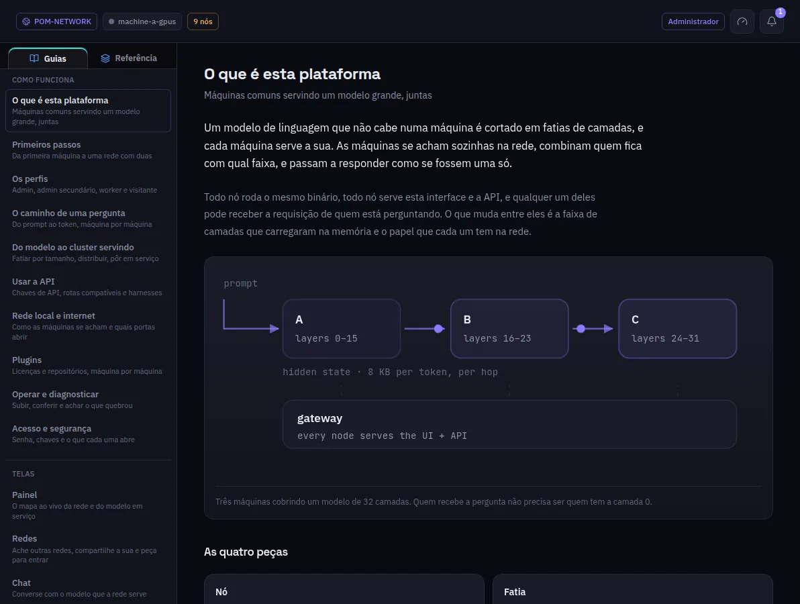

:::lead
Documentação tem duas metades. **Guias** são escritos para pessoas: como o POM funciona, um guia por tela, as configurações da implantação e como cada parte do código pensa. **Referência** é a documentação viva do repositório, escrita para quem muda o código.
:::

:::cards
### Busca
A caixa no topo busca na aba que está aberta: em Guias, cada título, resumo e texto; em Referência, cada documento.
### Grupos de guias
Como funciona, Telas, Configurações da implantação e Por dentro do código. Um plugin pode acrescentar guias próprios, listados depois.
### Ir mais fundo
Cada guia termina com links para a referência, com o detalhe completo do que ele explica.
:::

:::note De onde vem o texto
Os guias são arquivos markdown em `docs/guides/` e `docs/human/` do repositório, um por idioma; a referência são os arquivos `AGENTS.md` e `docs/subsystems/`. Os dois viajam dentro da interface, então funcionam em qualquer máquina sem internet.
:::
