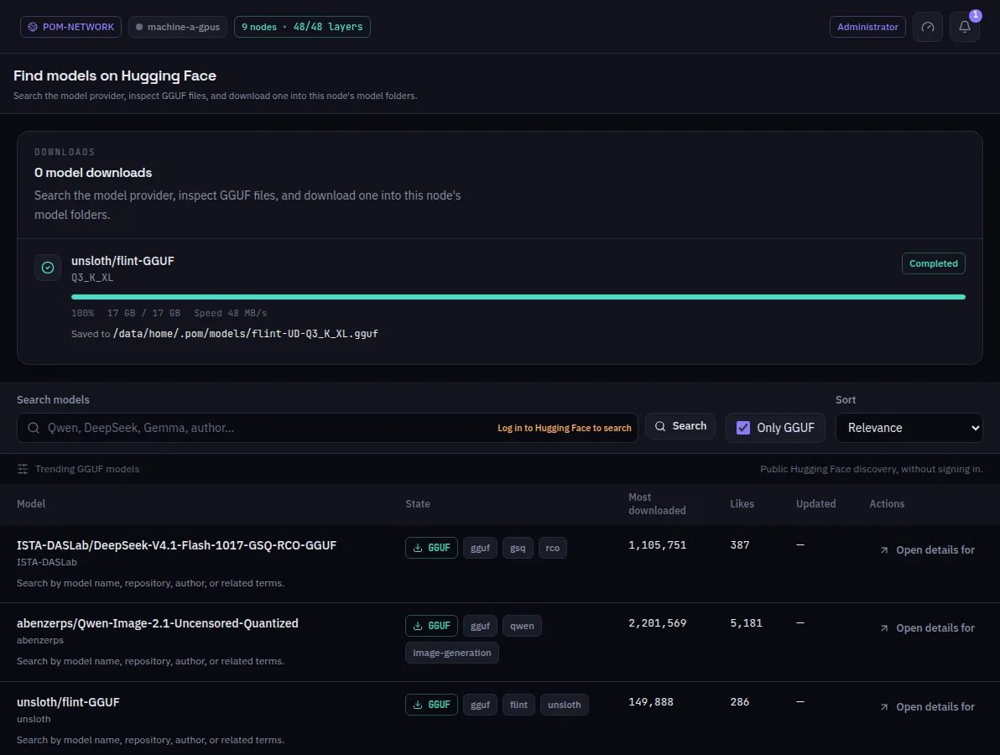

:::lead
This screen brings models from Hugging Face to this machine: it opens with the trending GGUF models, searches by name or author, shows the files of each repository and downloads the one you pick into this machine's model folders.
:::

:::steps
### Search
Type a model, an author or a related term. **Only GGUF** keeps the list to files POM can load; **Sort** orders by relevance, downloads, likes or date.
### Open the details
Each repository lists its GGUF files with their sizes, and the license. A gated model is marked before any download.
### Download
The dialog shows the folder the file goes to. The download keeps running if you leave the screen or reload it, and it shows up in Transfers too.
:::

:::note Signing in is optional
The trending list uses Hugging Face's public listing. Signing in (the link in the search bar, with a token saved in Preferences) is what opens the search and the gated models your account may download.
:::

:::note Only this machine
The file lands on this machine. To serve it on several machines, either download it on each one or slice it here and let each machine take its own range.
:::

:::deep docs/subsystems/http-api.md
The model provider routes: search, details and downloads
:::
