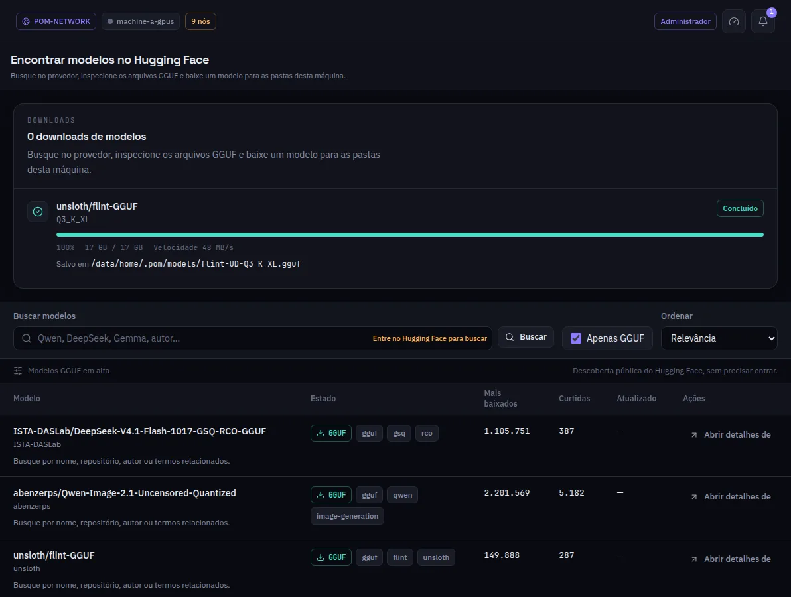

:::lead
Esta tela traz modelos do Hugging Face para esta máquina: abre com os modelos GGUF em alta, busca por nome ou autor, mostra os arquivos de cada repositório e baixa o que você escolher para as pastas de modelos desta máquina.
:::

:::steps
### Buscar
Digite um modelo, um autor ou um termo relacionado. **Apenas GGUF** deixa só os arquivos que o POM carrega; **Ordenar** ordena por relevância, downloads, curtidas ou data.
### Abrir os detalhes
Cada repositório lista os arquivos GGUF com os tamanhos e a licença. Um modelo restrito (gated) é marcado antes de qualquer download.
### Baixar
O diálogo mostra a pasta para onde o arquivo vai. Quando o download começa, o diálogo e os detalhes do modelo se fecham e o progresso aparece no painel de downloads. **Cancelar** tira do painel um download ainda não concluído, e **Tentar de novo** num download que falhou o substitui pela nova tentativa; **Descartar** tira do painel um download que falhou, sem tentar de novo. O download continua se você sair da tela ou recarregar, e aparece também em Transferências.
:::

:::note Entrar é opcional
A lista em alta usa a listagem pública do Hugging Face. Entrar (o link na barra de busca, com um token salvo em Preferências) é o que abre a busca e os modelos restritos que a sua conta pode baixar.
:::

:::note Só nesta máquina
O arquivo vai para esta máquina. Para servi-lo em várias máquinas, baixe em cada uma ou fatie aqui e deixe cada máquina pegar a própria faixa.
:::

:::deep docs/subsystems/http-api.md
As rotas do provedor de modelos: busca, detalhes e downloads
:::
