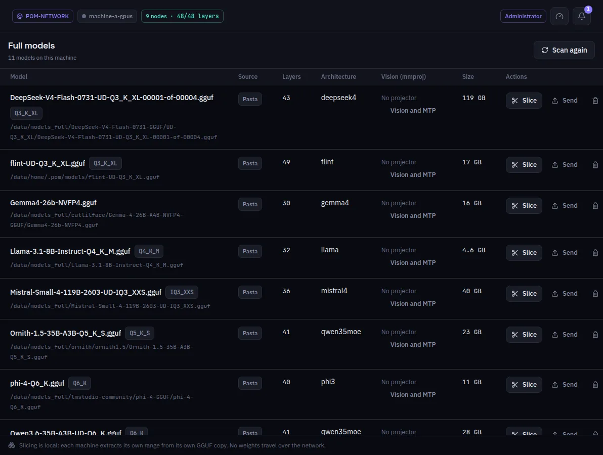

:::lead
Models lists every whole GGUF model this machine found in its model folders: an Ollama store, an LM Studio library or a plain folder of GGUF files. Multipart models stay as one model entry, with each physical part (for example, `0001-of-0004`) and its size listed underneath; each part can be deleted individually. The **Image**, **Vision (mmproj)** and **MTP drafts** tabs list their local files and let you delete them individually. Deleting a file currently used by the running model or as its active projector/draft shows an interruption warning. To download a model, use Search Models, the Hugging Face plugin's screen.
:::

:::video https://www.youtube.com/watch?v=lCYW3TJ70M8
Video: the Models screens - full models, slices and transfers - explained.
:::

:::cards
### Layers and architecture
Read from the GGUF header, without loading the model. The number of layers is what a deploy divides into ranges.
### Vision and MTP files
The **Vision (mmproj)** and **MTP drafts** tabs show the local files, paths, metadata and sizes. The vision projector associated with a model is also shown on its row. **Vision and MTP** links a projector or an MTP draft found anywhere in the network to this model.
### Slice
Only in development mode: opens Tensor parallel shards with this file chosen. A pipeline deploy needs no slicing.
### Image models
The **Image** tab lists image files in the same folders with what each one is: diffusion model, text encoder, VAE, checkpoint, LoRA, ControlNet, CLIP Vision or upscaler, read from the file's own header, never from its name. Family and data type come from the same header. These files are deleted here; they are not sliced.
:::

:::note Where these files come from
The folders scanned are set in Settings > Storage. **Scan again** reads them once more after you copy a file by hand.
:::

:::note Slicing is local
Each machine extracts its own range from its own copy of the GGUF. No weights travel over the network because of slicing.
:::

:::deep docs/subsystems/slicing.md
How a GGUF is read and cut
:::
