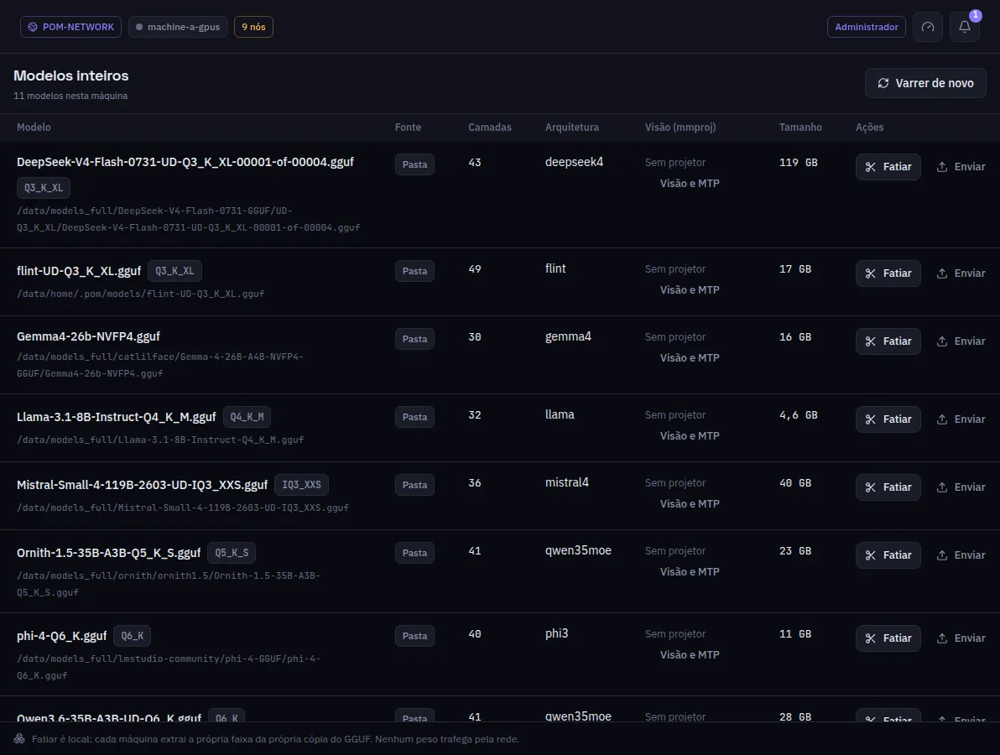

:::lead
Modelos lista cada modelo GGUF inteiro encontrado nas pastas desta máquina: um repositório do Ollama, uma biblioteca do LM Studio ou uma pasta comum de GGUF. Modelos multipart continuam em uma única entrada, com cada parte física (por exemplo, `0001-of-0004`) e seu tamanho listados abaixo; cada parte pode ser apagada individualmente. As abas **Imagem**, **Visão (mmproj)** e **Rascunhos MTP** listam os arquivos locais e permitem apagá-los individualmente. Apagar um arquivo usado pelo modelo em execução ou como projetor/rascunho ativo mostra um aviso de interrupção. Para baixar um modelo, use Procurar Modelos, a tela do plugin do Hugging Face.
:::

:::video https://www.youtube.com/watch?v=lCYW3TJ70M8
Vídeo: as telas de Modelos - modelos inteiros, fatias e transferências - explicadas.
:::

:::cards
### Camadas e arquitetura
Lidas do cabeçalho do GGUF, sem carregar o modelo. O número de camadas é o que uma implantação divide em faixas.
### Arquivos de visão e MTP
As abas **Visão (mmproj)** e **Rascunhos MTP** mostram arquivos locais, caminhos, metadados e tamanhos. O projetor de visão associado a um modelo também aparece em sua linha. **Visão e MTP** liga a este modelo um projetor ou rascunho MTP encontrado em qualquer máquina da rede.
### Fatiar
Só no modo de desenvolvimento: abre Partes tensor-parallel com este arquivo escolhido. Uma implantação em pipeline não precisa fatiar.
### Modelos de imagem
A aba **Imagem** lista os arquivos de imagem das mesmas pastas com o que cada um é: modelo de difusão, text encoder, VAE, checkpoint, LoRA, ControlNet, CLIP Vision ou upscaler, lido do cabeçalho do próprio arquivo, nunca do nome. Família e tipo de dado vêm do mesmo cabeçalho. Esses arquivos são apagados daqui; não são fatiados.
:::

:::note De onde vêm estes arquivos
As pastas lidas são definidas em Configurações > Armazenamento. **Varrer de novo** lê de novo depois que você copia um arquivo à mão.
:::

:::note O fatiamento é local
Cada máquina extrai a própria faixa da própria cópia do GGUF. Nenhum peso viaja pela rede por causa do fatiamento.
:::

:::deep docs/subsystems/slicing.md
Como um GGUF é lido e cortado
:::
