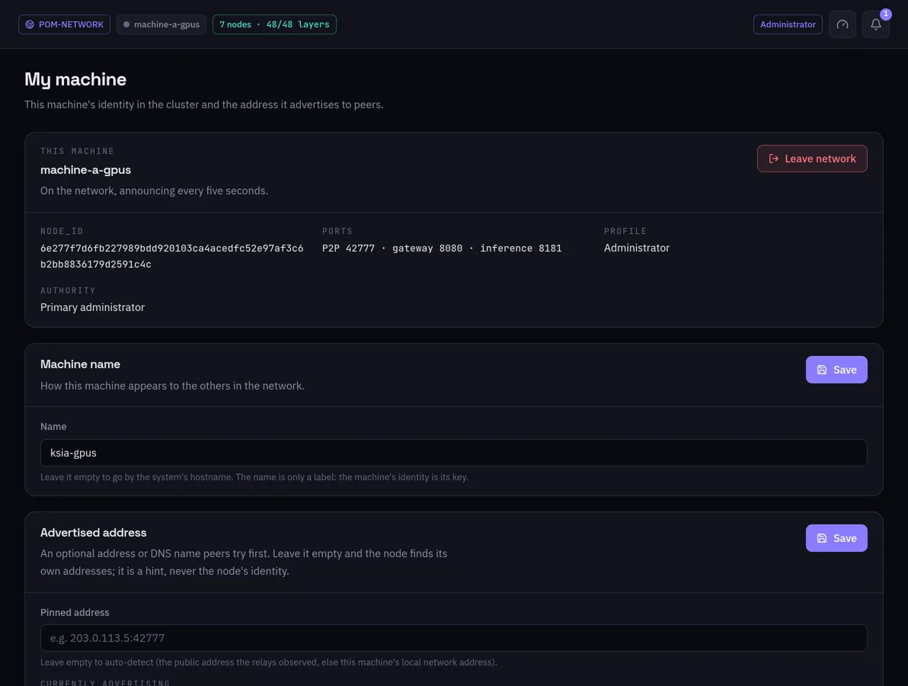

:::lead
My machine shows who this machine is in the network - its key, its ports, its profile and its authority - and lets you change the three things about it that are yours to change: its name, the address it advertises, and how it connects.
:::

:::cards
### node_id
The machine's identity in the network, derived from its key file. It is never the IP: deleting that key makes a new machine in the eyes of the others.
### Ports
P2P (discovery), gateway (this interface and the API) and inference (the hops between machines).
### Profile and authority
Administrator, worker, validator or visitor, and whether this machine is the principal administrator, a secondary one or neither. A validator is a worker that re-runs sampled work to check the others and serves no model.
### Machine name
Only a label for the others. Left empty, the system's hostname is used.
### Advertised address
An optional address or DNS name the others try first. Empty, the node finds its own addresses: the public one the relays observed, else the local network one. It is a hint, never the identity. **Announce only this address** makes it the only direct address the others get: when the address belongs to one of this machine's interfaces, the node also listens on it alone (from the next start), so two nodes on one computer - one on the host network, one in a container - stop switching between several equal paths, which kept the processor busy. Relays stay as a fallback.
### Connections
How this machine reaches the network. With iroh on, it uses discovery, relays and hole punching. With iroh off, it keeps none of that: it speaks and is reached on its announced addresses only - the worker the outside world never sees, for a machine the hub or the local network dials directly. Turning iroh off applies at once; turning it back on takes effect on the next start, and a mode the command line turned on stays until the flag is removed. A machine behind a NAT cannot have iroh off: with no hole punching its addresses stop answering and the hub refuses it.
:::

:::warn Leave network
**Leave network** disconnects this machine from the network it joined. Its own local network comes back exactly as it was.
:::

:::deep docs/subsystems/p2p-network.md
Identity, addresses and how peers are reached
:::
