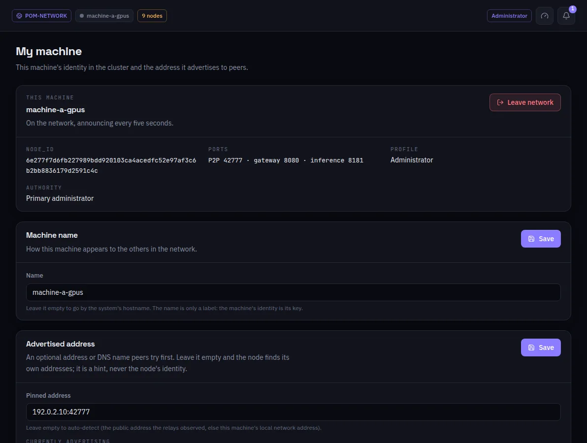

:::lead
My machine shows who this machine is in the network - its key, its ports, its profile and its authority - and lets you change the two things about it that are yours to change: its name and the address it advertises.
:::

:::cards
### node_id
The machine's identity in the network, derived from its key file. It is never the IP: deleting that key makes a new machine in the eyes of the others.
### Ports
P2P (discovery), gateway (this interface and the API) and inference (the hops between machines).
### Profile and authority
Administrator, worker or visitor, and whether this machine is the principal administrator, a secondary one or neither.
### Machine name
Only a label for the others. Left empty, the system's hostname is used.
### Advertised address
An optional address or DNS name the others try first. Empty, the node finds its own addresses: the public one the relays observed, else the local network one. It is a hint, never the identity.
:::

:::warn Leave network
**Leave network** disconnects this machine from the network it joined. Its own local network comes back exactly as it was.
:::

:::deep docs/subsystems/p2p-network.md
Identity, addresses and how peers are reached
:::
