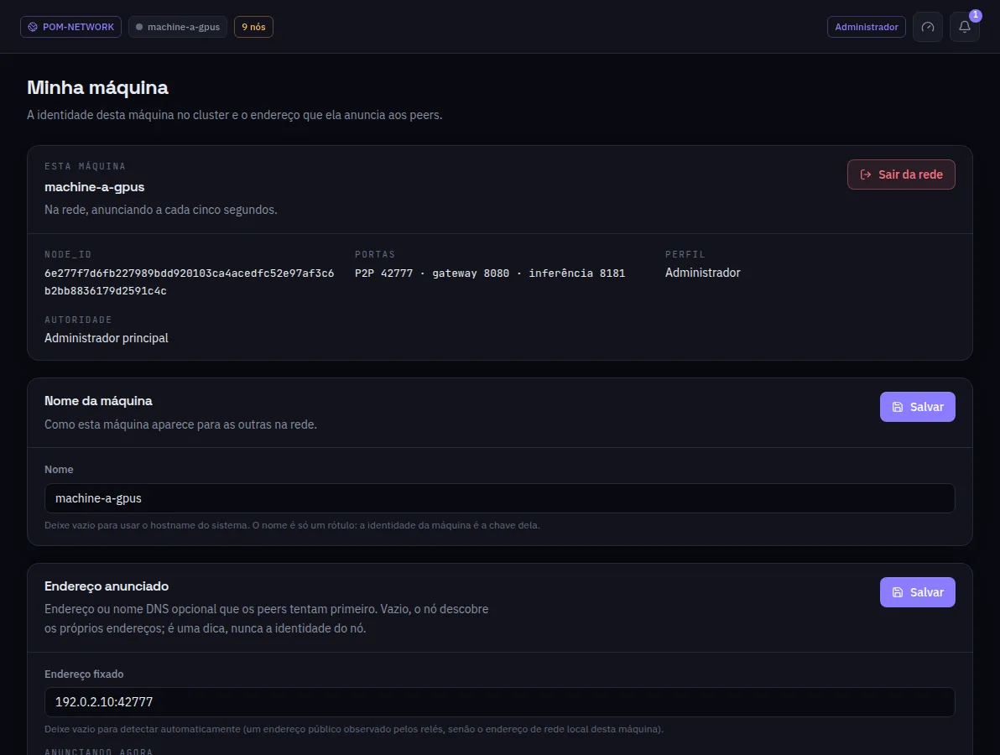

:::lead
Minha máquina mostra quem esta máquina é na rede - a chave, as portas, o perfil e a autoridade - e deixa mudar as duas coisas que são suas: o nome e o endereço que ela anuncia.
:::

:::cards
### node_id
A identidade da máquina na rede, derivada do arquivo de chave dela. Nunca é o IP: apagar essa chave cria uma máquina nova aos olhos das outras.
### Portas
P2P (descoberta), gateway (esta interface e a API) e inferência (os saltos entre máquinas).
### Perfil e autoridade
Administrador, worker ou visitante, e se esta máquina é a administradora principal, uma secundária ou nenhuma das duas.
### Nome da máquina
Só um rótulo para as outras. Vazio, usa o hostname do sistema.
### Endereço anunciado
Um endereço ou nome DNS opcional que as outras tentam primeiro. Vazio, o nó descobre os próprios endereços: o público que os relés observaram, senão o da rede local. É uma dica, nunca a identidade.
:::

:::warn Sair da rede
**Sair da rede** desconecta esta máquina da rede em que ela entrou. A rede local própria dela volta exatamente como estava.
:::

:::deep docs/subsystems/p2p-network.md
Identidade, endereços e como os peers são alcançados
:::
