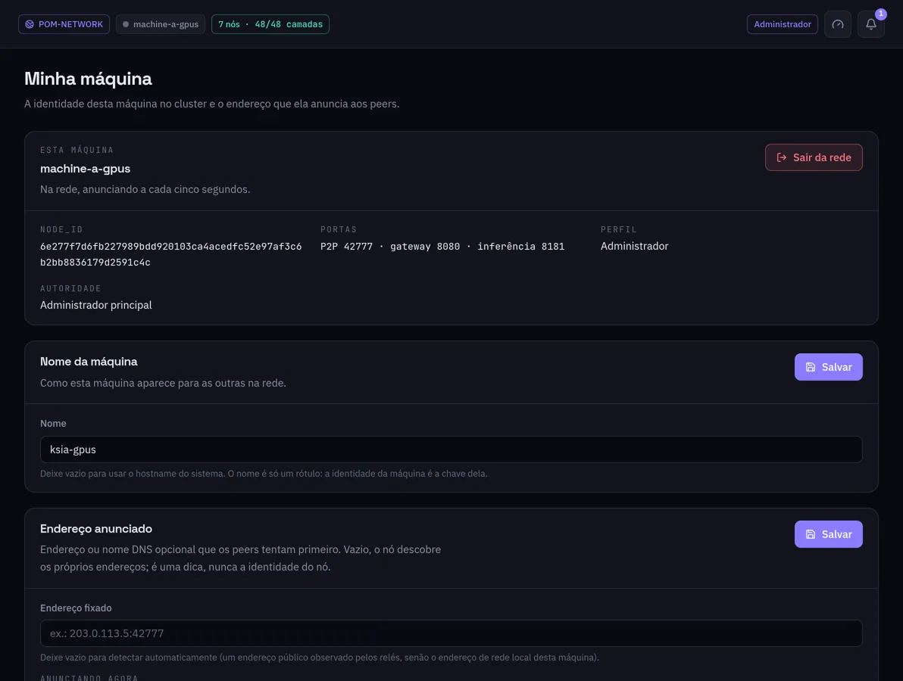

:::lead
Minha máquina mostra quem esta máquina é na rede - a chave, as portas, o perfil e a autoridade - e deixa mudar as três coisas que são suas: o nome, o endereço que ela anuncia e como ela se conecta.
:::

:::cards
### node_id
A identidade da máquina na rede, derivada do arquivo de chave dela. Nunca é o IP: apagar essa chave cria uma máquina nova aos olhos das outras.
### Portas
P2P (descoberta), gateway (esta interface e a API) e inferência (os saltos entre máquinas).
### Perfil e autoridade
Administrador, worker, validador ou visitante, e se esta máquina é a administradora principal, uma secundária ou nenhuma das duas. Um validador é um worker que reexecuta trabalho amostrado para conferir os outros e não serve modelo.
### Nome da máquina
Só um rótulo para as outras. Vazio, usa o hostname do sistema.
### Endereço anunciado
Um endereço ou nome DNS opcional que as outras tentam primeiro. Vazio, o nó descobre os próprios endereços: o público que os relés observaram, senão o da rede local. É uma dica, nunca a identidade.
### Conexões
Como esta máquina alcança a rede. Com o iroh ligado, ela usa descoberta, relés e furos de NAT. Com o iroh desligado, não usa nada disso: fala e é alcançada só nos endereços que anuncia - o worker que o mundo externo nunca vê, para uma máquina que o hub ou a rede local discam direto. Desligar o iroh vale na hora; religá-lo vale na próxima iniciação, e um modo ligado pela linha de comando fica até a flag ser retirada. Uma máquina atrás de NAT não pode ter o iroh desligado: sem furar o NAT seus endereços param de responder e o hub a recusa.
:::

:::warn Sair da rede
**Sair da rede** desconecta esta máquina da rede em que ela entrou. A rede local própria dela volta exatamente como estava.
:::

:::deep docs/subsystems/p2p-network.md
Identidade, endereços e como os peers são alcançados
:::
