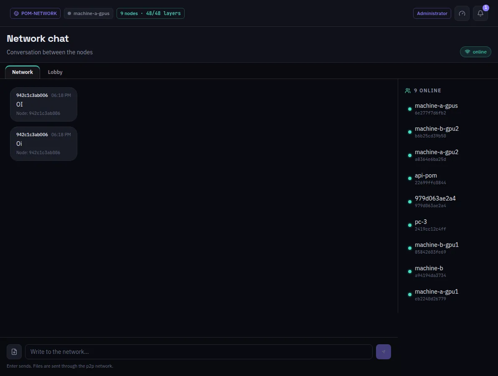

:::lead
The Network Chat is a conversation between the machines of the network, not with a model: the people operating each machine write here, and files can go along. On the right, who is online.
:::

:::cards
### Network
The room every member of the network reads. Messages and files travel over the network itself, and the principal machine validates them.
### Lobby
The administrator's room with the machines that are asking to join. Each candidate has a thread of its own, with **Approve** and **Decline** above the messages. It shows only when the network keeps its lobby open.
:::

:::note Low priority on purpose
Chat traffic yields to inference: a message never slows a question being answered.
:::

:::note Unread messages
The menu entry counts the messages you have not read; opening the screen marks them as read.
:::

:::deep docs/subsystems/p2p-network.md
How the chat travels between machines
:::
