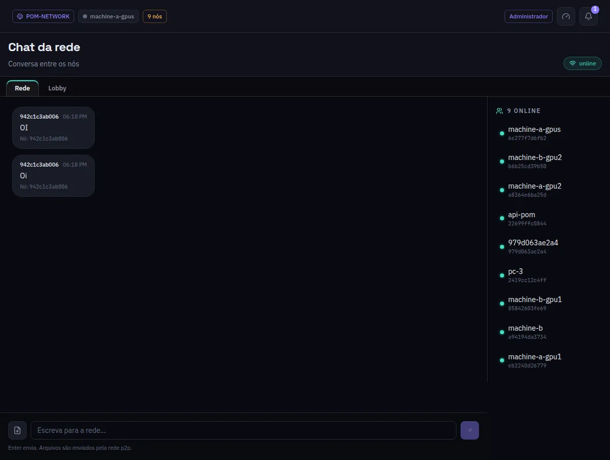

:::lead
O Chat da rede é uma conversa entre as máquinas da rede, não com um modelo: as pessoas que operam cada máquina escrevem aqui, e arquivos podem ir junto. À direita, quem está online.
:::

:::cards
### Rede
A sala que todo membro da rede lê. Mensagens e arquivos viajam pela própria rede, e a máquina principal os valida.
### Lobby
A sala do administrador com as máquinas que estão pedindo para entrar. Cada candidata tem uma conversa própria, com **Aprovar** e **Recusar** acima das mensagens. Só aparece quando a rede mantém o lobby aberto.
:::

:::note Baixa prioridade de propósito
O tráfego do chat cede lugar à inferência: uma mensagem nunca atrasa uma pergunta sendo respondida.
:::

:::note Mensagens não lidas
A entrada do menu conta as mensagens que você não leu; abrir a tela marca como lidas.
:::

:::deep docs/subsystems/p2p-network.md
Como o chat viaja entre as máquinas
:::
