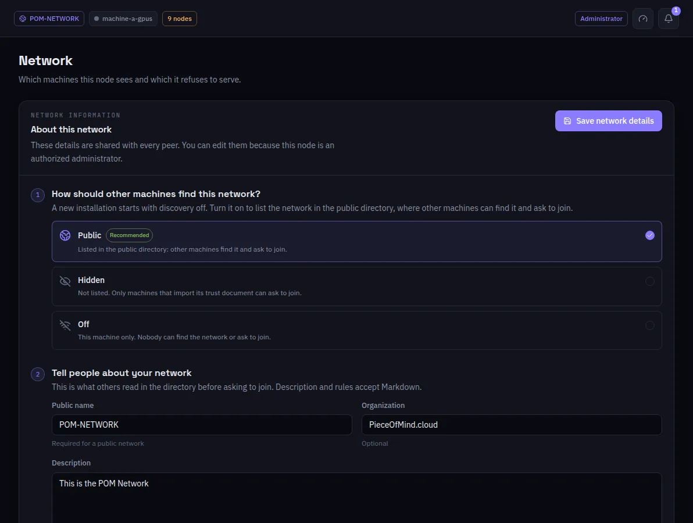

:::lead
This screen is the portrait of the network this machine is in: how other machines find it, what it tells them, who may join and in which role, and where it is. An authorized administrator edits it; everyone else reads it.
:::

:::steps
### How others find this network
**Public** lists it in the public directory, where others find it and ask to join. **Hidden** keeps it out of the listings: only a machine that imports its trust file can ask. **Off** keeps it to this machine. A new installation starts with discovery off.
### Tell people about your network
The public name, the organization, the description and the rules are what others read before asking to join. Description and rules accept Markdown.
### Who can join
Approved by an administrator, anyone without approval, or this machine only - and which roles are accepted: worker, visitor, administrator. Unchecking every role advertises the network as closed.
### Where it is
On a public network, the location on a map, which the directory uses for the distance between networks.
:::

:::cards
### Relay
When the internet reaches this machine, it relays for the members of its own network by default; relaying for everyone is an option here.
### NAT traversal
The panel tells, for two machines that cannot see each other, at which of the three steps it fails: the NAT report, the relays or the hole punch.
### Admitted machines
The approved admissions, each with **Revoke** behind a confirmation.
### GPU work metering
The principal turns metering on or off here, at any time: the payout cycle, the grace before a cycle closes, samples and challenges per machine, the penalty, the verifier, and whether Strata stages are re-executed. Every machine follows within seconds. The ledger itself is the metering plugin on one admin; the panel warns when this machine does not run it.
:::

:::note Saving propagates
A change is written on this node, signed, sent to every peer and published to the directory.
:::

:::deep docs/subsystems/p2p-network.md
Discovery, relays and NAT traversal
:::

:::deep docs/subsystems/security-model.md
Who may change what in a network
:::
