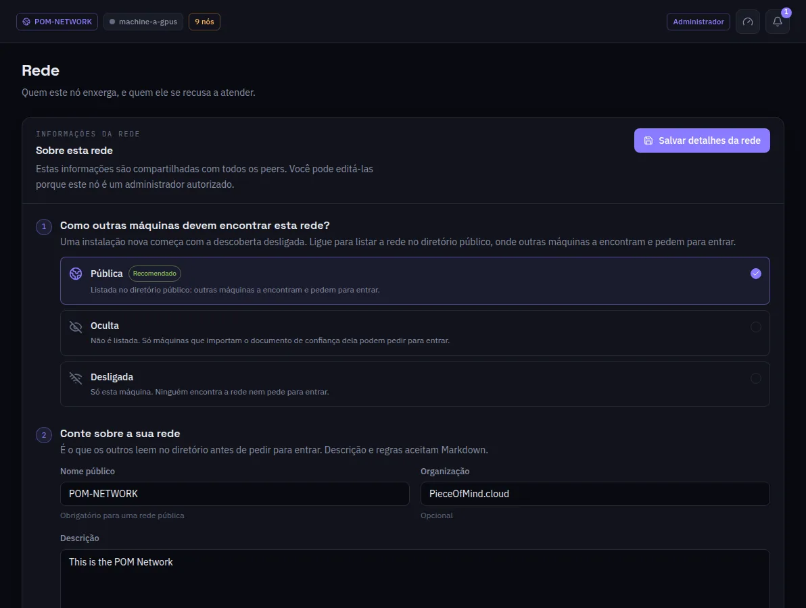

:::lead
Esta tela é o retrato da rede em que esta máquina está: como outras máquinas a encontram, o que ela diz a elas, quem pode entrar e em que papel, e onde ela fica. Um administrador autorizado edita; os demais leem.
:::

:::steps
### Como os outros acham esta rede
**Pública** lista a rede no diretório público, onde outros a encontram e pedem para entrar. **Oculta** deixa fora das listas: só uma máquina que importa o arquivo de confiança dela pode pedir. **Desligada** a mantém só nesta máquina. Uma instalação nova começa com a descoberta desligada.
### Conte sobre a sua rede
O nome público, a organização, a descrição e as regras são o que os outros leem antes de pedir para entrar. Descrição e regras aceitam Markdown.
### Quem pode entrar
Aprovado por um administrador, qualquer um sem aprovação, ou só esta máquina - e quais papéis são aceitos: worker, visitante, administrador. Desmarcar todos os papéis anuncia a rede como fechada.
### Onde ela fica
Numa rede pública, a localização num mapa, que o diretório usa para a distância entre redes.
:::

:::cards
### Relé
Quando a internet alcança esta máquina, ela faz relé para os membros da própria rede por padrão; fazer relé para todos é uma opção aqui.
### Travessia de NAT
O painel diz, para duas máquinas que não se enxergam, em qual dos três passos falha: o relatório de NAT, os relés ou o hole punch.
### Máquinas admitidas
As admissões aprovadas, cada uma com **Revogar** atrás de uma confirmação.
### Medição de trabalho de GPU
O principal liga ou desliga a medição aqui, a qualquer momento: o ciclo de pagamento, a tolerância antes de um ciclo fechar, amostras e desafios por máquina, a penalidade, o verificador e se os estágios do Strata são reexecutados. Toda máquina acompanha em segundos. O livro em si é o plugin de medição em um admin; o painel avisa quando esta máquina não o roda.
:::

:::note Salvar propaga
Uma mudança é escrita neste nó, assinada, enviada a cada peer e publicada no diretório.
:::

:::deep docs/subsystems/p2p-network.md
Descoberta, relés e travessia de NAT
:::

:::deep docs/subsystems/security-model.md
Quem pode mudar o quê numa rede
:::
