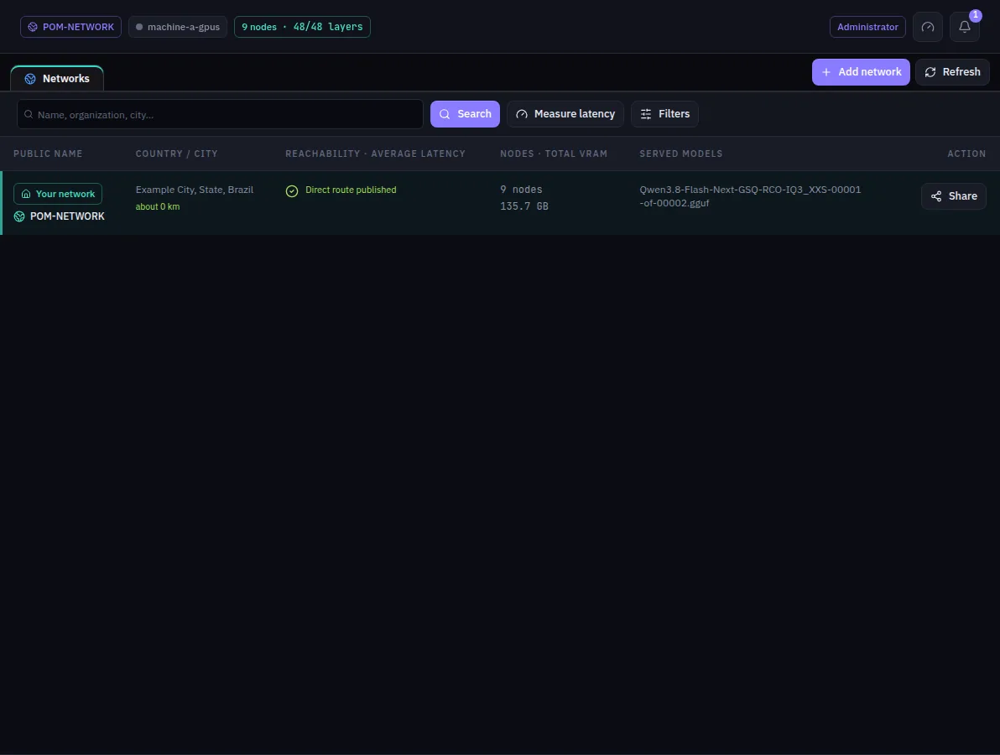

:::lead
Networks is the directory: your own network sits at the top, and below it the public networks this machine has found, with where they are, how many machines they have, which models they serve and how far they are from you.
:::

## Reading a row

:::cards
### Name and place
The public name, and the city the network published, with the distance from your network below it.
### Reachability and latency
Whether the network published a direct route or only a relay. After **Measure latency**, the time it takes to answer, colored green under 60 ms, amber under 150 ms, orange under 300 ms and red above that. No IP is ever shown.
### Nodes and VRAM
How many machines the network has and how much graphics memory they add up to. A dash means the network does not publish that number.
### Served models
The models in service there, three at most in the row and the full list in the side panel.
:::

Clicking a row opens a panel on the right with the description, the rules and the roles the network accepts, and the actions: **Ask to join**, **Lobby** to talk to its administrators before asking, **Leave network** for a network you are in, and **More details** with every technical field.

## Toolbar

:::steps
### Search
Type a name, an organization or a city and press **Search**.
### Filter
**Filters** opens country, city, distance radius and order. Any change goes back to the first page.
### Measure latency
Measures how long each network on the page takes to answer and reorders by it.
### Add network or share yours
**Add network** reads the trust file another network gave you. **Share** (on your own row) downloads your network's trust file to take to another machine.
:::

:::note Closer is better
A question crosses one machine at a time, so the distance between machines weighs on every token. Prefer networks in your city or region.
:::

:::warn A public network sees your questions
On a public network your machine also works for others, and theirs work for you. Keep sensitive data on a private network.
:::

:::deep docs/subsystems/p2p-network.md
Discovery, the public directory and how a network is reached
:::
