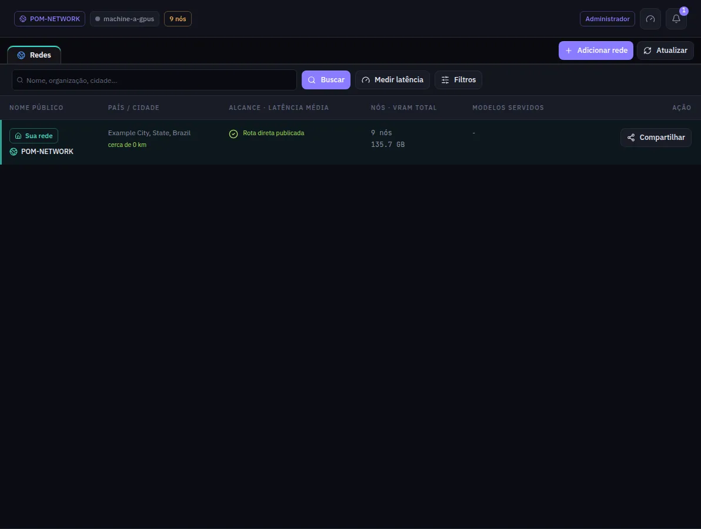

:::lead
Redes é o diretório: a sua própria rede fica no topo e, abaixo dela, as redes públicas que esta máquina encontrou, com onde ficam, quantas máquinas têm, que modelos servem e a que distância estão de você.
:::

## Lendo uma linha

:::cards
### Nome e lugar
O nome público e a cidade que a rede publicou, com a distância até a sua rede embaixo.
### Alcance e latência
Se a rede publicou uma rota direta ou só um relé. Depois de **Medir latência**, o tempo que ela leva para responder, em verde abaixo de 60 ms, âmbar abaixo de 150 ms, laranja abaixo de 300 ms e vermelho acima disso. Nenhum IP aparece.
### Nós e VRAM
Quantas máquinas a rede tem e quanta memória de vídeo elas somam. Um traço quer dizer que a rede não publica esse número.
### Modelos servidos
Os modelos em serviço lá, no máximo três na linha e a lista completa no painel lateral.
:::

Clicar numa linha abre um painel à direita com a descrição, as regras e os papéis que a rede aceita, e as ações: **Pedir para entrar**, **Lobby** para conversar com os administradores antes de pedir, **Sair da rede** para uma rede em que você está, e **Mais detalhes** com todos os campos técnicos.

## Barra de ferramentas

:::steps
### Buscar
Digite um nome, uma organização ou uma cidade e clique em **Buscar**.
### Filtrar
**Filtros** abre país, cidade, raio de distância e ordem. Qualquer mudança volta para a primeira página.
### Medir latência
Mede quanto cada rede da página leva para responder e reordena por isso.
### Adicionar uma rede ou compartilhar a sua
**Adicionar rede** lê o arquivo de confiança que outra rede te passou. **Compartilhar** (na sua própria linha) baixa o arquivo de confiança da sua rede para levar a outra máquina.
:::

:::note Perto é melhor
Uma pergunta atravessa uma máquina de cada vez, então a distância entre elas pesa em cada token. Prefira redes na sua cidade ou região.
:::

:::warn Uma rede pública vê as suas perguntas
Numa rede pública a sua máquina também trabalha para os outros, e as deles para você. Deixe os dados sensíveis numa rede privada.
:::

:::deep docs/subsystems/p2p-network.md
Descoberta, o diretório público e como uma rede é alcançada
:::
