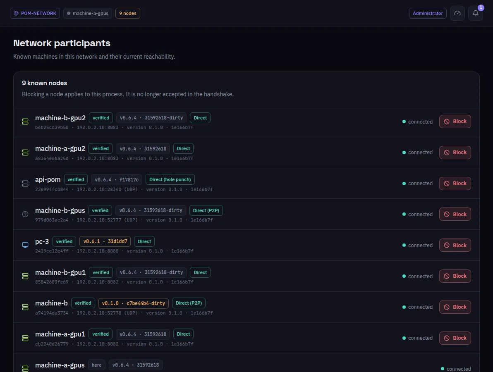

:::lead
Network participants lists the machines this one knows in the network: their name, whether their identity was verified, the POM version they run, the route in use to reach them, the layers they serve and whether they are connected.
:::

:::cards
### verified
The machine proved its identity: its certificate derives from its key, and it holds an admin's membership token.
### Version
The POM release it announces. Amber means it is not the same as this machine's.
### Route
How this machine reaches it right now: **Direct**, **Direct (P2P)**, **Direct (hole punch)** or through a relay, and which kind of relay. The advertised address only goes into the tooltip; the route shown is the one in use.
### Block
Refuses that machine in the handshake from now on. It is an administrator's action; the button only shows for one.
:::

:::note Identity, not address
A machine is its key. The same machine may change its IP and stays the same row; deleting its key makes a new one.
:::

:::deep docs/subsystems/security-model.md
Membership, revocation and blocking
:::
