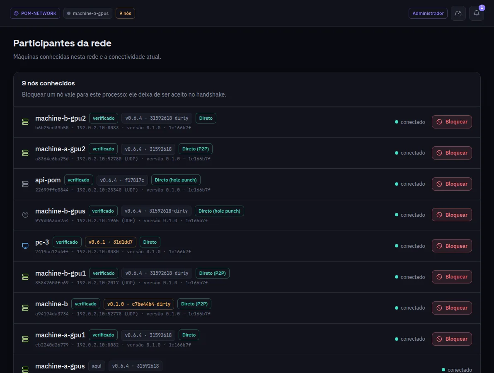

:::lead
Participantes da rede lista as máquinas que esta conhece na rede: o nome, se a identidade foi verificada, a versão do POM que rodam, a rota em uso para alcançá-las, as camadas que servem e se estão conectadas.
:::

:::cards
### verificado
A máquina provou a identidade: o certificado dela deriva da chave, e ela tem um token de membro assinado por um admin.
### Versão
A versão do POM que ela anuncia. Âmbar quer dizer que não é a mesma desta máquina.
### Rota
Como esta máquina a alcança agora: **Direta**, **Direta (P2P)**, **Direta (hole punch)** ou por um relé, e qual tipo de relé. O endereço anunciado só aparece na dica; a rota mostrada é a que está em uso.
### Bloquear
Recusa aquela máquina no handshake daqui em diante. É uma ação de administrador; o botão só aparece para um.
:::

:::note Identidade, não endereço
Uma máquina é a chave dela. A mesma máquina pode mudar de IP e continua a mesma linha; apagar a chave cria uma nova.
:::

:::deep docs/subsystems/security-model.md
Associação, revogação e bloqueio
:::
