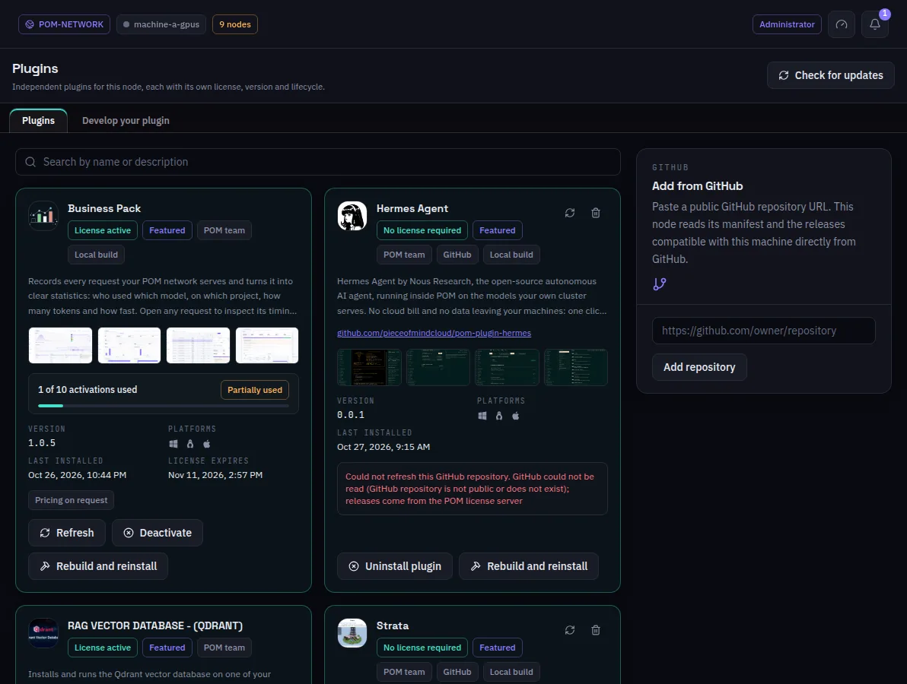

:::lead
Plugins is the store of this machine: every plugin of the catalog, free or paid, with its state here - installed, licensed, up to date - and the actions to install, activate, update or remove it. Each plugin is independent and runs in a process of its own beside the node.
:::

## A plugin card

:::cards
### Badges
**License active** or **No license required**, **Featured** and **POM team** for plugins published by the POM team, and where it came from: GitHub, or a **Local build**.
### Version and platforms
The installed version (or the newest this machine can install) and the systems the plugin supports. A release built for another system is never offered.
### Activations
For a licensed plugin, how many of the license's activations are in use and when the license expires.
### Actions
**Refresh**, **Deactivate**, **Uninstall plugin**, or **Install** for one not installed yet. A plugin with settings has a gear that opens them.
:::

## Getting a plugin

:::steps
### From the store
Free plugins install with one click. A paid plugin opens the purchase page in your browser; the license key it gives you is pasted in the license form here and activates every plugin that key grants. A plugin marked **Coming soon** is already announced but has no release yet: it shows in the list with nothing to buy or install.
### From GitHub
**Add from GitHub** takes the address of a public repository and installs its newest release compatible with this machine. A plugin outside the POM team asks for a confirmation first: its code was not reviewed.
### Keeping them current
**Check for updates** asks every installed plugin and POM itself at once, and lists what is newer. POM installs last, because it restarts the node.
:::

:::note Develop your plugin
The second tab points to the example plugin and to the page where a plugin is submitted to the store. On a machine in development mode, a plugin with mounted sources also gets **Rebuild and reinstall**; a local build grants no licensed feature.
:::

:::diagram plugins
Each plugin runs in a process of its own beside the node. The license or the GitHub repository counts for this machine only.
:::

:::deep docs/subsystems/enterprise-licensing.md
Licenses, the process host and updates
:::

:::deep docs/subsystems/plugins-ui.md
How a plugin adds menus and screens
:::
