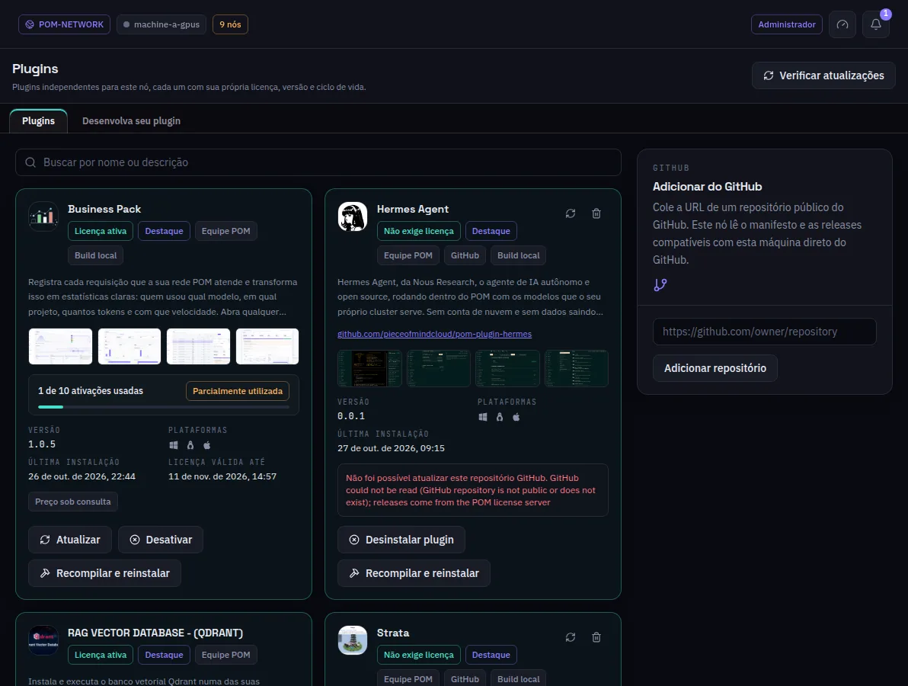

:::lead
Plugins é a loja desta máquina: cada plugin do catálogo, gratuito ou pago, com o estado dele aqui - instalado, licenciado, atualizado - e as ações para instalar, ativar, atualizar ou remover. Cada plugin é independente e roda num processo próprio ao lado do nó.
:::

## Um cartão de plugin

:::cards
### Selos
**Licença ativa** ou **Não exige licença**, **Destaque** e **Equipe POM** para plugins publicados pela equipe do POM, e de onde ele veio: GitHub, ou um **Build local**.
### Versão e plataformas
A versão instalada (ou a mais nova que esta máquina pode instalar) e os sistemas que o plugin suporta. Uma versão feita para outro sistema nunca é oferecida.
### Ativações
Para um plugin licenciado, quantas ativações da licença estão em uso e quando a licença vence.
### Ações
**Atualizar**, **Desativar**, **Desinstalar plugin**, ou **Instalar** para um ainda não instalado. Um plugin com configurações tem uma engrenagem que as abre.
:::

## Conseguindo um plugin

:::steps
### Da loja
Plugins gratuitos instalam com um clique. Um plugin pago abre a página de compra no seu navegador; a chave de licença que ela te dá é colada no formulário de licença daqui e ativa todos os plugins que aquela chave concede.
### Do GitHub
**Adicionar do GitHub** recebe o endereço de um repositório público e instala a versão mais nova compatível com esta máquina. Um plugin de fora da equipe do POM pede uma confirmação antes: o código dele não foi revisado.
### Mantendo em dia
**Verificar atualizações** consulta todos os plugins instalados e o próprio POM de uma vez, e lista o que há de mais novo. O POM é instalado por último, porque reinicia o nó.
:::

:::note Desenvolva seu plugin
A segunda aba aponta para o plugin de exemplo e para a página onde um plugin é enviado à loja. Numa máquina em modo de desenvolvimento, um plugin com o código-fonte montado também ganha **Recompilar e reinstalar**; uma compilação local não concede nenhum recurso licenciado.
:::

:::diagram plugins
Cada plugin roda num processo próprio ao lado do nó. A licença ou o repositório GitHub vale só para esta máquina.
:::

:::deep docs/subsystems/enterprise-licensing.md
Licenças, o host de processos e as atualizações
:::

:::deep docs/subsystems/plugins-ui.md
Como um plugin adiciona menus e telas
:::
