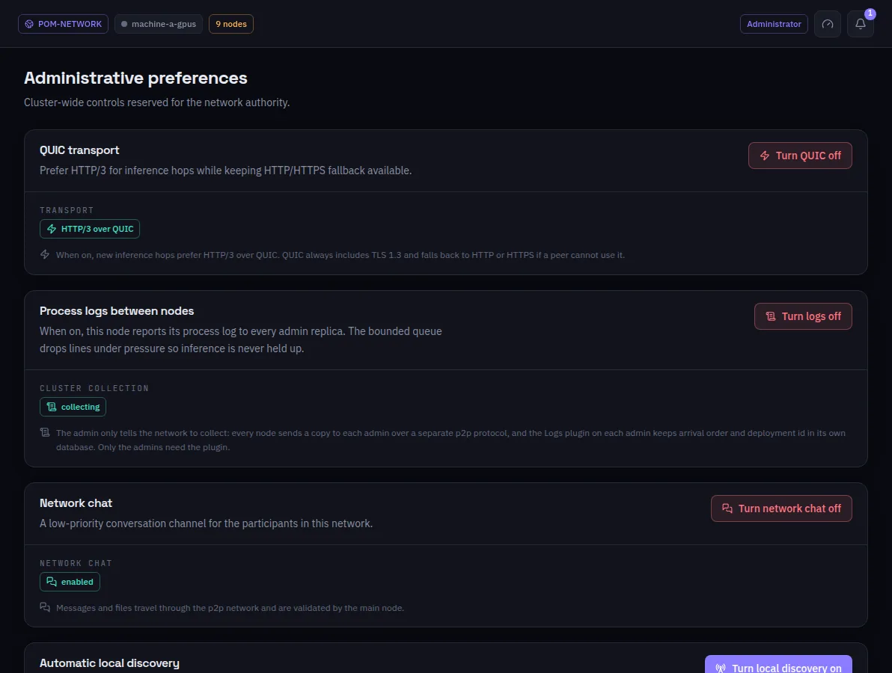

:::lead
Administrative preferences are the switches that change the whole network, not just this machine, and that only the network's authority may turn.
:::

:::cards
### QUIC transport
When on, new inference hops prefer HTTP/3 over QUIC. QUIC always carries TLS 1.3 and falls back to HTTP or HTTPS when a peer cannot use it.
### Process logs between nodes
When on, every node sends a copy of its process log to each administrator over a separate channel; the Deployment logs screen reads it. The queue drops lines under pressure, so inference is never held up.
### Network chat
The low-priority conversation channel between the participants. Messages and files travel over the network and are validated by the principal machine.
### Automatic local discovery
Lets machines on the same local network find each other by broadcast. It is off by default.
:::

:::deep docs/subsystems/p2p-network.md
Transport, logs and chat between machines
:::
