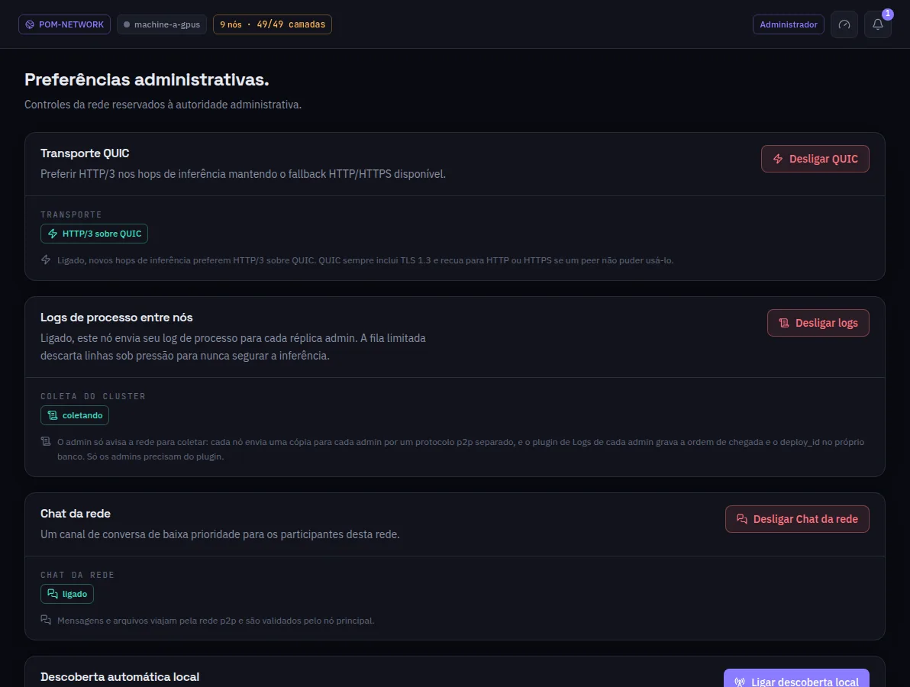

:::lead
Preferências administrativas são as chaves que mudam a rede inteira, não só esta máquina, e que só a autoridade da rede pode virar.
:::

:::cards
### Transporte QUIC
Ligado, os novos saltos de inferência preferem HTTP/3 sobre QUIC. O QUIC sempre leva TLS 1.3 e volta para HTTP ou HTTPS quando um peer não consegue usá-lo.
### Logs de processo entre nós
Ligado, cada nó manda uma cópia do log de processo a cada administrador por um canal separado; a tela Logs da implantação lê isso. A fila descarta linhas sob pressão, então a inferência nunca é segurada.
### Chat da rede
O canal de conversa de baixa prioridade entre os participantes. Mensagens e arquivos viajam pela rede e são validados pela máquina principal.
### Descoberta local automática
Deixa as máquinas da mesma rede local se acharem por broadcast. Vem desligada.
:::

:::deep docs/subsystems/p2p-network.md
Transporte, logs e chat entre máquinas
:::
