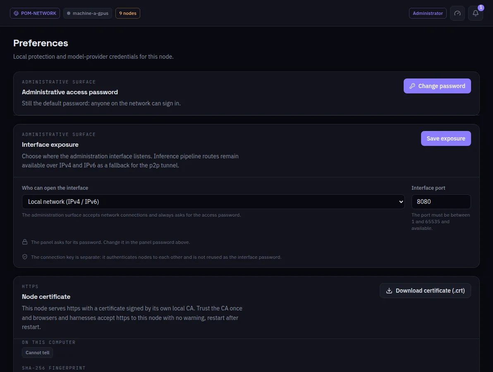

:::lead
Preferences holds what belongs to this machine alone: the password of this panel, where the interface listens, the node's HTTPS certificate and the GPU thermal protection. The Hugging Face token is set on the Settings tab of Search Models, the Hugging Face plugin's screen.
:::

:::cards
### Administrative access password
A new node opens with the password `admin` and the bell asks to change it. **Change password** sets a new one; the node keeps only its Argon2id hash, never the password.
### Interface exposure
Who can open this interface - only this computer, or the local network (IPv4/IPv6) - and on which port. The network mode always asks for the password. The inference routes between machines stay open either way.
### Node certificate
The node serves HTTPS with a certificate signed by its own local CA. **Download certificate (.crt)** and trust it once, and browsers and harnesses accept HTTPS to this node with no warning.
### Thermal protection
The GPU temperature policy for deployments.
:::

:::warn The password is not the connection key
The panel password is a human credential for this interface. The connection key authenticates the machines to each other and is never reused as the password.
:::

:::deep docs/subsystems/web-ui.md
Exposure, the panel password and HTTPS
:::
