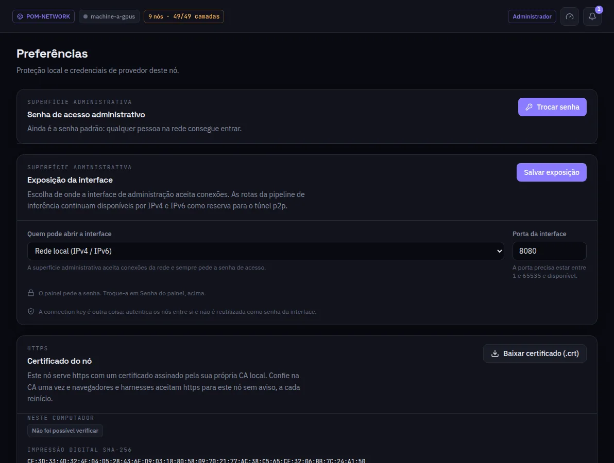

:::lead
Preferências guarda o que é só desta máquina: a senha deste painel, onde a interface escuta, o certificado HTTPS do nó e a proteção térmica da GPU. O token do Hugging Face fica na aba Configurações de Procurar Modelos, a tela do plugin do Hugging Face.
:::

:::cards
### Senha de acesso administrativo
Um nó novo abre com a senha `admin` e o sino pede para trocar. **Trocar senha** define uma nova; o nó guarda só o hash Argon2id dela, nunca a senha.
### Exposição da interface
Quem pode abrir esta interface - só este computador, ou a rede local (IPv4/IPv6) - e em qual porta. O modo de rede sempre pede a senha. As rotas de inferência entre máquinas continuam abertas de qualquer jeito.
### Certificado do nó
O nó serve HTTPS com um certificado assinado pela própria CA local. **Baixar certificado (.crt)** e confiar nele uma vez faz navegadores e harnesses aceitarem HTTPS para este nó sem aviso.
### Proteção térmica
A política de temperatura da GPU para as implantações.
:::

:::warn A senha não é a chave de conexão
A senha do painel é uma credencial humana para esta interface. A chave de conexão autentica as máquinas entre si e nunca é reaproveitada como senha.
:::

:::deep docs/subsystems/web-ui.md
Exposição, a senha do painel e HTTPS
:::
