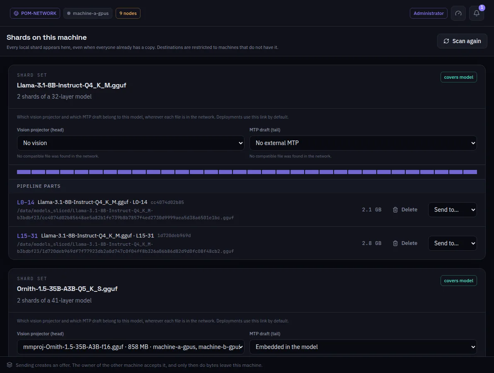

:::lead
Shards lists every slice this machine holds, grouped by the model it came from, and says whether each set covers the whole model. From here a slice is deleted. Slices are kept for sets made before a machine could serve a range of the whole model, and for inference services that run slices in stages; they are no longer sent between machines.
:::

:::video https://www.youtube.com/watch?v=lCYW3TJ70M8
Video: the Models screens - full models, slices and transfers - explained.
:::

:::cards
### The set
One model cut into slices. **covers model** means the parts together hold every layer; the bar shows which layers are there.
### Vision and MTP
Which vision projector (used by the first slice) and which MTP draft (used by the last one) belong to this model, wherever each file is in the network. Deployments use this link by default.
### Pipeline parts
Each slice with its layer range, its file and its size.
### Tensor parallel parts
When a model was cut for tensor parallelism, its ranks show apart, labeled `1of2`, `2of2` and so on.
:::

:::deep docs/subsystems/deployment.md
How slices are put in service
:::
