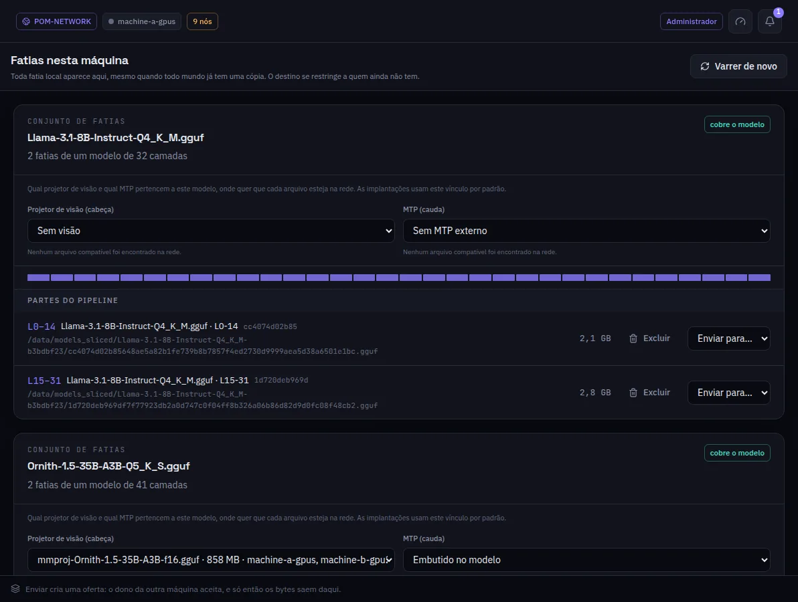

:::lead
Fatias lista cada fatia que esta máquina guarda, agrupadas pelo modelo de onde vieram, e diz se cada conjunto cobre o modelo inteiro. Daqui uma fatia é enviada a outra máquina ou apagada.
:::

:::video https://www.youtube.com/watch?v=lCYW3TJ70M8
Vídeo: as telas de Modelos - modelos inteiros, fatias e transferências - explicadas.
:::

:::cards
### O conjunto
Um modelo cortado em fatias. **cobre o modelo** quer dizer que as partes juntas têm todas as camadas; a barra mostra quais camadas estão lá.
### Visão e MTP
Qual projetor de visão (usado pela primeira fatia) e qual rascunho MTP (usado pela última) pertencem a este modelo, esteja cada arquivo onde estiver na rede. As implantações usam essa ligação por padrão.
### Partes do pipeline
Cada fatia com a faixa de camadas, o arquivo e o tamanho. **Enviar para...** oferece só às máquinas que ainda não a têm.
### Partes de tensor paralelo
Quando um modelo foi cortado para paralelismo de tensor, os ranks aparecem à parte, marcados `1of2`, `2of2` e assim por diante.
:::

:::note Enviar é uma oferta
A outra máquina vê a oferta no sino e decide. Só depois que ela aceita os bytes saem desta máquina.
:::

:::deep docs/subsystems/deployment.md
Como as fatias entram em serviço
:::
