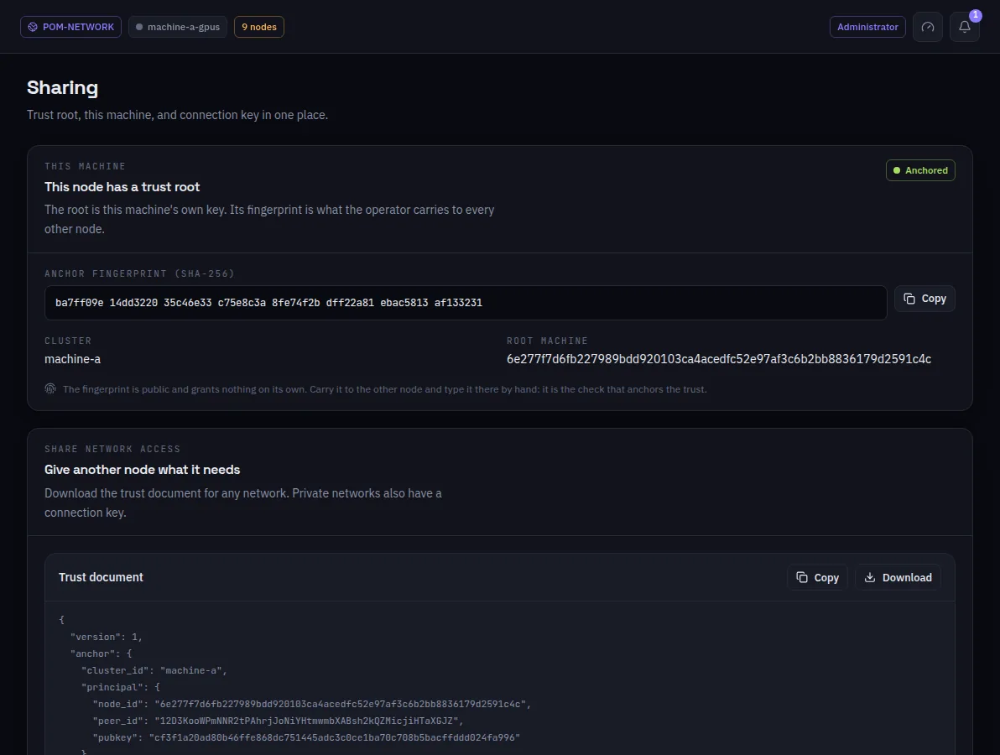

:::lead
Sharing gathers what another machine needs to trust this network: the fingerprint of the trust root, the trust document to download, and, for a private network, the connection key.
:::

:::steps
### The trust root
The root is this machine's own key. **Anchored** means this node already has one. Its fingerprint is public and grants nothing on its own.
### Carry the fingerprint
Take the fingerprint to the other machine by a channel you trust - read it out, type it there by hand. That check is what anchors the trust.
### Give the trust document
**Download** the trust document and add it on the other machine, in Networks > Add network. A private network also needs its connection key, which only the principal hands over.
:::

:::note Trust root, the older address
The Trust root entry opens this same screen; it is kept for old links.
:::

:::deep docs/subsystems/security-model.md
The trust chain and how a machine anchors it
:::
