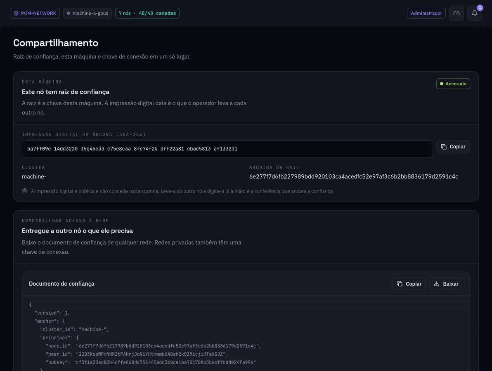

:::lead
Compartilhamento reúne o que outra máquina precisa para confiar nesta rede: a impressão digital da raiz de confiança, o documento de confiança para baixar e, numa rede privada, a chave de conexão.
:::

:::steps
### A raiz de confiança
A raiz é a chave da própria máquina. **Ancorada** quer dizer que este nó já tem uma. A impressão digital é pública e não concede nada sozinha.
### Levar a impressão digital
Leve a impressão digital até a outra máquina por um canal em que você confia - leia em voz alta, digite lá à mão. Essa conferência é o que ancora a confiança.
### Entregar o documento de confiança
**Baixe** o documento de confiança e adicione na outra máquina, em Redes > Adicionar rede. Uma rede privada também precisa da chave de conexão, que só o principal entrega.
:::

:::note A chave de conexão
A mesma string em todas as máquinas da rede: ela autentica as rotas de administração e a sincronização entre os nós, mas sozinha não abre nada, porque toda chamada entre máquinas também é TLS mútuo, e quem chama precisa ser membro hoje: um admin da cadeia, ou uma máquina que o roster atesta e que nenhum admin baniu. Esta tela a mostra com o endereço de bootstrap e a URL base da API; **Gerar outra** a troca só nesta máquina, e as outras deixam de aceitar esta até receberem a chave nova. Só quem tem autoridade vê o botão.
:::

:::note Raiz de confiança, o endereço antigo
O endereço antigo da Raiz de confiança (`/config/trust`) ainda abre a parte da raiz de confiança desta tela, para links antigos; ele não está mais no menu.
:::

:::deep docs/subsystems/security-model.md
A cadeia de confiança e como uma máquina a ancora
:::
