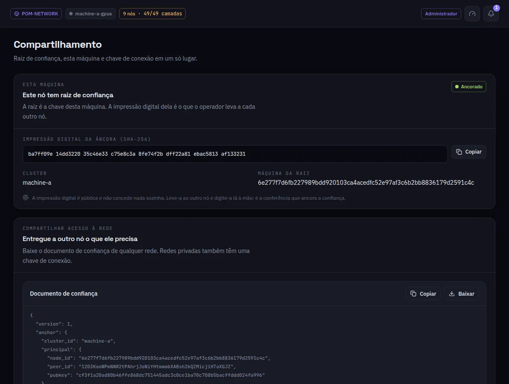

:::lead
Compartilhamento reúne o que outra máquina precisa para confiar nesta rede: a impressão digital da raiz de confiança, o documento de confiança para baixar e, numa rede privada, a chave de conexão.
:::

:::steps
### A raiz de confiança
A raiz é a chave da própria máquina. **Ancorada** quer dizer que este nó já tem uma. A impressão digital é pública e não concede nada sozinha.
### Levar a impressão digital
Leve a impressão digital até a outra máquina por um canal em que você confia - leia em voz alta, digite lá à mão. Essa conferência é o que ancora a confiança.
### Entregar o documento de confiança
**Baixe** o documento de confiança e adicione na outra máquina, em Redes > Adicionar rede. Uma rede privada também precisa da chave de conexão, que só o principal entrega.
:::

:::note Raiz de confiança, o endereço antigo
A entrada Raiz de confiança abre esta mesma tela; ela fica para links antigos.
:::

:::deep docs/subsystems/security-model.md
A cadeia de confiança e como uma máquina a ancora
:::
