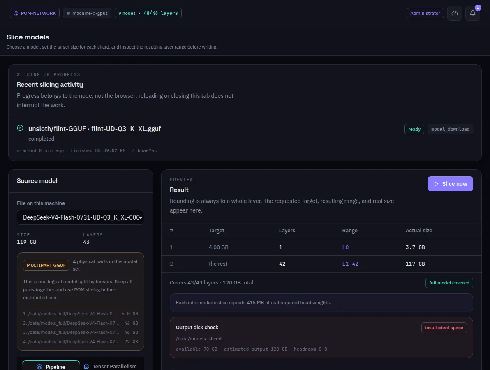

:::lead
Slice models cuts a whole GGUF into slices of layers. You say how big each slice should be, the preview shows the layer range and the real size each one gets, and only then the files are written.
:::

:::steps
### Choose the source model
Only whole models can be sliced. A model split into several physical parts shows every part and asks to keep them together.
### Give a target per slice
One size in GB per slice; an empty last line means "the rest". **Slice one layer range** cuts a single exact range instead.
### Read the preview
Each slice gets a whole number of layers, so the real size is rounded. The preview also shows how much of the model's head every intermediate slice repeats.
### Check the disk
The output disk check compares the free space of the slice folder with what the plan needs, and warns before the slicing starts.
### Slice now
The job shows its phase and the bytes read while it runs, and stays in the list when it ends or fails.
:::

:::diagram slicing
A 32-layer GGUF cut by size target, not into equal parts.
:::

:::note You may not need this screen
Deploying a model across machines asks each machine to cut its own range from its own copy. This screen is for preparing slices ahead of time or for a machine that will receive a slice instead of the whole file.
:::

:::deep docs/subsystems/slicing.md
Required tensors, repeated heads and size planning
:::
