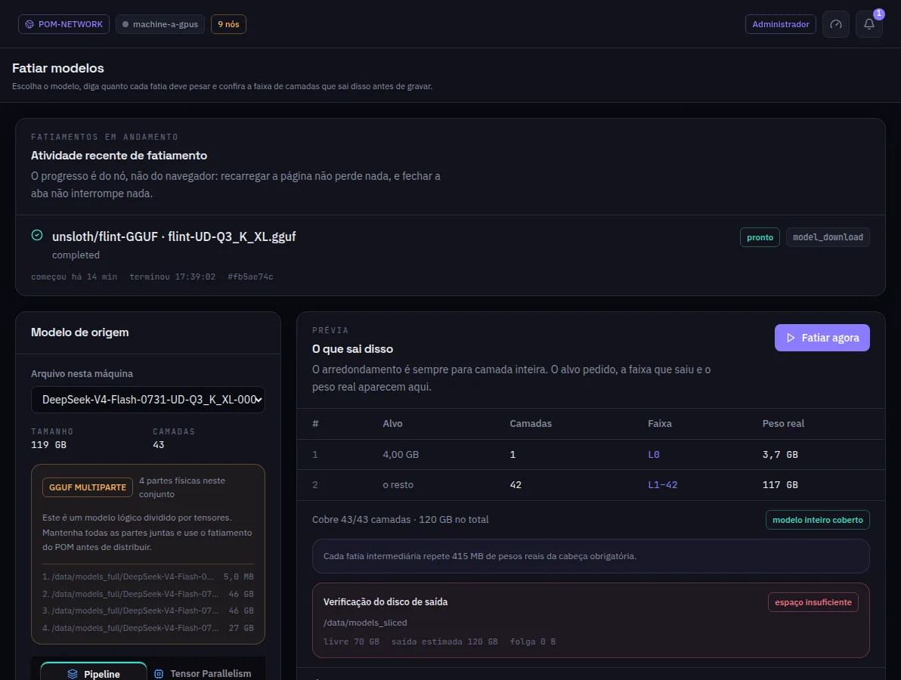

:::lead
Fatiar modelos corta um GGUF inteiro em fatias de camadas. Você diz o tamanho de cada fatia, a prévia mostra a faixa de camadas e o tamanho real que cada uma ganha, e só então os arquivos são escritos.
:::

:::steps
### Escolher o modelo de origem
Só modelos inteiros podem ser fatiados. Um modelo dividido em várias partes físicas mostra cada parte e pede para mantê-las juntas.
### Dar um alvo por fatia
Um tamanho em GB por fatia; uma última linha vazia quer dizer "o resto". **Fatiar uma faixa específica** corta uma única faixa exata.
### Ler a prévia
Cada fatia ganha um número inteiro de camadas, então o tamanho real é arredondado. A prévia também mostra quanto da cabeça do modelo cada fatia intermediária repete.
### Conferir o disco
A verificação de disco compara o espaço livre da pasta de fatias com o que o plano precisa, e avisa antes de o fatiamento começar.
### Fatiar agora
O trabalho mostra a fase e os bytes lidos enquanto roda, e fica na lista quando termina ou falha.
:::

:::diagram slicing
Um GGUF de 32 camadas cortado por alvo de tamanho, não em partes iguais.
:::

:::note Talvez você nem precise desta tela
Implantar um modelo em várias máquinas pede a cada máquina que corte a própria faixa da própria cópia. Esta tela serve para preparar fatias com antecedência, ou para uma máquina que vai receber uma fatia em vez do arquivo inteiro.
:::

:::deep docs/subsystems/slicing.md
Tensores obrigatórios, cabeças repetidas e planejamento por tamanho
:::
