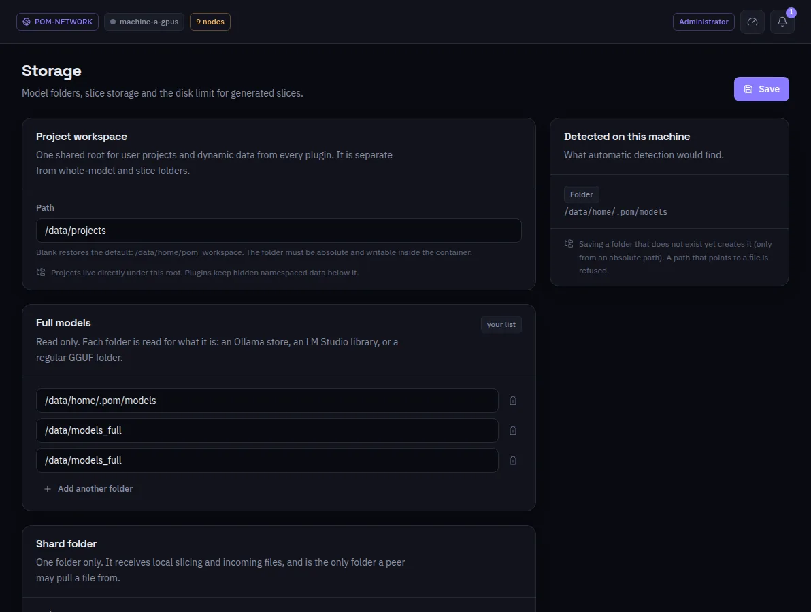

:::lead
Storage tells this machine where to look for models, where to write slices and how much disk slices may take, plus the shared folder plugins use for projects.
:::

:::cards
### Project workspace
One shared root for user projects and the data of every plugin, separate from the model folders. Blank restores the default.
### Full models
Read-only folders, each read for what it is: an Ollama store, an LM Studio library or a plain GGUF folder. **Add another folder** for more.
### Shard folder
One folder only. It receives local slicing and incoming files, and it is the only folder another machine may pull a file from. It cannot be a model folder or sit inside one.
### Slice limit
How much disk generated slices may use, shown against what they use now.
:::

:::note A folder that does not exist yet
Saving a folder that does not exist creates it, as long as the path is absolute. A path that points to a file is refused.
:::

:::deep docs/subsystems/slicing.md
Catalog reads and where slices are written
:::
