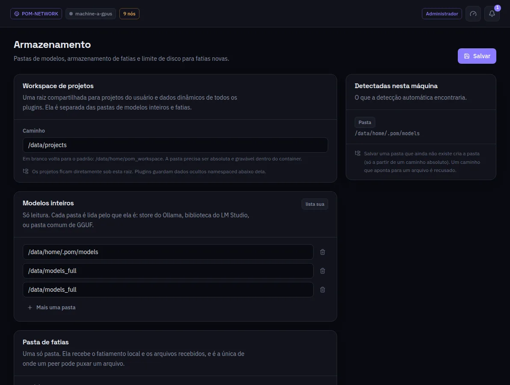

:::lead
Armazenamento diz a esta máquina onde procurar modelos, onde escrever fatias e quanto disco as fatias podem ocupar, além da pasta compartilhada que os plugins usam para projetos.
:::

:::cards
### Workspace de projetos
Uma raiz compartilhada para os projetos do usuário e os dados de cada plugin, separada das pastas de modelos. Vazio volta ao padrão.
### Modelos inteiros
Pastas só de leitura, cada uma lida pelo que é: um repositório do Ollama, uma biblioteca do LM Studio ou uma pasta comum de GGUF. **Mais uma pasta** para outras. Um arquivo copiado à mão para uma delas aparece depois de **Varrer pastas**, sem esperar a próxima varredura.
### Pasta de fatias
Uma pasta só. Ela recebe o fatiamento local e os arquivos que chegam, e é a única pasta de onde outra máquina pode puxar um arquivo. Não pode ser uma pasta de modelos nem ficar dentro de uma.
### Limite de fatias
Quanto disco as fatias geradas podem usar, ao lado do que usam agora.
:::

:::note Uma pasta que ainda não existe
Salvar uma pasta que não existe cria a pasta, desde que o caminho seja absoluto. Um caminho que aponta para um arquivo é recusado.
:::

:::deep docs/subsystems/slicing.md
Leitura do catálogo e onde as fatias são escritas
:::
